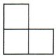
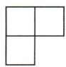
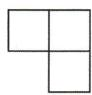
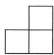
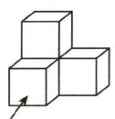
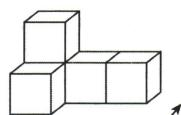
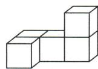
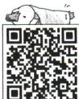
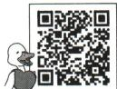

## 课时 2 有理数的加法运算律 刷基础

A

B

C

D

  
从正面看

图(1)

图(2)

(第1题图)

(第2题图)

![[初中/课堂同步/教辅/必刷题/2026版《初中必刷题》数学 BS  7上/02_第二章_有理数及其运算/课时_2_有理数的加法运算律/questions/Q00097923.md]]
![[初中/课堂同步/教辅/必刷题/2026版《初中必刷题》数学 BS  7上/02_第二章_有理数及其运算/课时_2_有理数的加法运算律/questions/Q00097924.md]]
## 知识点 2 由物体的形状图得到立体图形

![[初中/课堂同步/教辅/必刷题/2026版《初中必刷题》数学 BS  7上/02_第二章_有理数及其运算/课时_2_有理数的加法运算律/questions/Q00097925.md]]
![[初中/课堂同步/教辅/必刷题/2026版《初中必刷题》数学 BS  7上/02_第二章_有理数及其运算/课时_2_有理数的加法运算律/questions/Q00097926.md]]
## e刷易错

## 易错点 对“暴露面”理解不清致错

![[初中/课堂同步/教辅/必刷题/2026版《初中必刷题》数学 BS  7上/02_第二章_有理数及其运算/课时_2_有理数的加法运算律/questions/Q00097927.md]]
# 全章综合训练

  
是个新“烤”鸭

  
电子错题本鸭

## 考点1 点、线、面、体
