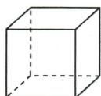
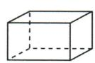
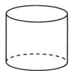
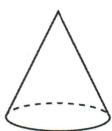
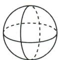
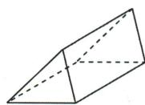
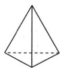
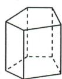

<!-- question-source:start -->
2[2024 江西九江质检]请将下列几何体分类(填序号).

(1) 如果按“柱”“锥”“球”来分, 柱体有\_\_\_\_, 锥体有\_\_\_\_, 球有\_\_\_\_;

(2)如果按“有无曲的面”来分,有曲的面的有\_\_\_\_,无曲的面的有\_\_\_\_;

(3) 如果按“有无顶点”来分, 有顶点的有\_\_\_\_, 无顶点的有\_\_\_\_.

①

②

③

④

⑤

⑥

⑦

⑧
<!-- question-source:end -->
