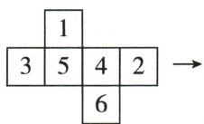
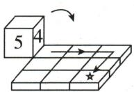
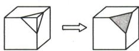

<!-- question-source:start -->
2[2025 河北秦皇岛质检, 中]图(1)的每一个正方形上都写有一个数字, 它可折叠成图(2)的正方体, 将正方体放在一个 $3 \times 3$ 的正方形网格平台上, 一次一个小格地按箭头所指的方向依次翻转, 当正方体落在位置“☆”时, 紧贴位置“☆”的一面上的数字为 ( )

  
图(1)

  
图(2)

A. 1 B. 3 C. 4 D. 6

<!-- question-source:end -->
