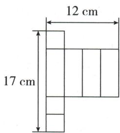

<!-- question-source:start -->
4[2024 江苏泰州姜堰区期末]在学习棱柱的展开与折叠时,老师让同学们用若干个正方形和长方形拼成一个长方体的展开图.拼完后(如图),小明觉得所拼图形似乎存在问题.

(1)请你帮小明分析一下所拼图形是否存在问题,若有多余块,请把图中多余块涂上阴影;若还缺少,请直接在原图中补全.

(2)长方体共有\_\_\_\_条棱,若将一个长方体沿某些棱剪开展成(1)中修正后的平面图形,需要剪开\_\_\_\_条棱.

(3)根据图中的数据,求出修正后的展开图所折叠而成的长方体的体积.

<!-- question-source:end -->
