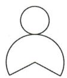
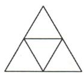
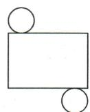

<!-- question-source:start -->
8[2024宁夏银川期中](1)请写出下列展开图对应的几何体的名称:①\_\_\_\_;②\_\_\_\_;③\_\_\_\_.

(2)③中的侧面展开图的宽(较短边)为8 cm, 圆的半径为2 cm, 其所对应的几何体的表面积为\_\_\_\_. (结果保留π)

①

②

③

<!-- question-source:end -->
