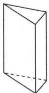
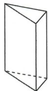
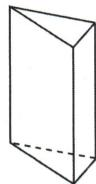

<!-- question-source:start -->
6[中]如图所示的是一个三棱柱,用一个平面先后三次截这个三棱柱.

(1)所得的截面能否是三个与该三棱柱的底面大小相同的三角形？若能，画图说明你的截法.

(2)截得的截面能否是三个长相等的长方形?若能,画图说明你的一种截法.

(3)截得的截面能否是梯形？若能，画图说明你的一种截法.

  
备用图(1)  
备用图(2)
<!-- question-source:end -->
