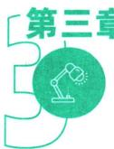
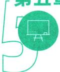

## 课时 2 用计算器进行运算

大招专题 1 有关数轴的探索 …… 刷难关 (38) (D22)
全章综合训练 …… 刷中考 章测 (39) (D23)

## 新考法 新素材

研究对比全国近十年中考真题卷,发现各省市的中考会不断借鉴或探究新考法,同时会挖掘时事热点等新素材,创造新情境灵活考查知识点。中考是我们平时学习的风向标,因此我们需要关注新考法、新素材。

## 新考法

\- 正方体的展开
- 从不同方向观察物体的应用
- 结合数轴考查有理数的减法
- 角的比较方法
- 角的和差运算
- P3/T2
- P10/T3
- P22/T1
- P64/T2
- P64/T5
- P83/T2
- 通过框图直观分析实际问题
- P85/T1

## 新素材

\- 以电影《哪吒之魔童闹海》为背景考查科学记数法 AI原创
- P33/T3
- 以 DeepSeek(深度求索)科技公司为背景考查列代数式 AI原创
- P42/T7

## 新考向

## 推荐理由

教育部发布的《关于加强初中学业水平考试命题工作的意见》中指出:弘扬中华优秀传统文化,提高探究性、开放性、综合性试题比例,积极探索跨学科命题,提高试题情境设计水平。结合《义务教育数学课程标准(2022年版)》新变化,通过分析全国百余套中考试题,发现以传统文化为背景的试题,以及探究性、开放性、综合性、跨学科试题在中考中出现得越来越频繁,故精选部分试题,让学生感受考向变化。

<table><tr><td>微专题1</td><td>绝对值最值问题</td><td>P16</td></tr><tr><td>微专题2</td><td>整式中不含(无关)问题</td><td>P50</td></tr><tr><td>微专题3</td><td>解含绝对值的一元一次方程</td><td>P75</td></tr></table>

## 目录

## 重难题型微课

<table><tr><td>正负数的应用</td><td>P12T3</td><td>数轴上的整点问题</td><td>P16T1</td></tr><tr><td>添“正、负号”求最值问题</td><td>P24T6</td><td>拆项法</td><td>P37T8</td></tr><tr><td>倒序相加法</td><td>P37T11</td><td>有理数加法法则的应用</td><td>P40T7</td></tr></table>

## 第三章 整式及其加减

![[初中/课堂同步/教辅/必刷题/2026版《初中必刷题》数学 BS  7上/02_第二章_有理数及其运算/课时_2_用计算器进行运算/questions/Q00095971.md]]
![[初中/课堂同步/教辅/必刷题/2026版《初中必刷题》数学 BS  7上/02_第二章_有理数及其运算/课时_2_用计算器进行运算/questions/Q00095972.md]]
![[初中/课堂同步/教辅/必刷题/2026版《初中必刷题》数学 BS  7上/02_第二章_有理数及其运算/课时_2_用计算器进行运算/questions/Q00095973.md]]
## 重难题型微课

整式运算中的整体思想 P50T6 日历表中的规律问题 P52T2  
整式加减运算中的无关问题 P57T13

## 第四章 基本平面图形

![[初中/课堂同步/教辅/必刷题/2026版《初中必刷题》数学 BS  7上/02_第二章_有理数及其运算/课时_2_用计算器进行运算/questions/Q00095974.md]]
![[初中/课堂同步/教辅/必刷题/2026版《初中必刷题》数学 BS  7上/02_第二章_有理数及其运算/课时_2_用计算器进行运算/questions/Q00095975.md]]
![[初中/课堂同步/教辅/必刷题/2026版《初中必刷题》数学 BS  7上/02_第二章_有理数及其运算/课时_2_用计算器进行运算/questions/Q00095976.md]]
## 重难题型微课

“折中点”问题 P60T4 直线上的动点问题 P60T5  
与线段中点有关的计算 P61T2 三等分线的分类讨论 P65T3  
旋转角的探究问题 P71T16

## 专题索引

## 微专题

## 重难专题

## 重难专题1 巧用运算规律简化有理数的计算 P37

类型1 归类组合法  
类型2 逆用乘法对加法的分配律  
类型3 凑整法  
类型4 分组搭配法  
类型5 拆项法  
类型6 倒数法  
类型7 倒序相加法

## 重难专题2 整式的化简求值 P51

类型1 化繁为简再求值  
类型2 整体代入求值  
类型3 整体加减求值  
类型4 整式的化简求值与数轴、绝对值的综合

## 重难专题3 线段的动态问题 P62

## 重难专题4 动角问题 P67

## 重难专题5 特殊一元一次方程的解题技巧 P78

类型1 分母化整再去分母  
类型2 利用倒数关系去括号  
类型3 整体思想的应用  
类型4 先拆分，再合并  
类型5 分组通分

## 目录

## 第五章 一元一次方程

![[初中/课堂同步/教辅/必刷题/2026版《初中必刷题》数学 BS  7上/02_第二章_有理数及其运算/课时_2_用计算器进行运算/questions/Q00095977.md]]
![[初中/课堂同步/教辅/必刷题/2026版《初中必刷题》数学 BS  7上/02_第二章_有理数及其运算/课时_2_用计算器进行运算/questions/Q00095978.md]]
![[初中/课堂同步/教辅/必刷题/2026版《初中必刷题》数学 BS  7上/02_第二章_有理数及其运算/课时_2_用计算器进行运算/questions/Q00095979.md]]
## 第六章 数据的收集与整理

![[初中/课堂同步/教辅/必刷题/2026版《初中必刷题》数学 BS  7上/02_第二章_有理数及其运算/课时_2_用计算器进行运算/questions/Q00095980.md]]
![[初中/课堂同步/教辅/必刷题/2026版《初中必刷题》数学 BS  7上/02_第二章_有理数及其运算/课时_2_用计算器进行运算/questions/Q00095981.md]]
![[初中/课堂同步/教辅/必刷题/2026版《初中必刷题》数学 BS  7上/02_第二章_有理数及其运算/课时_2_用计算器进行运算/questions/Q00095982.md]]
## 综合与实践

关注人口老龄化 …… 刷实践（103）(D63)
制作一个尽可能大的无盖长方体形收纳盒 …… 刷实践（104）(D63)

## 中考新考向备训

\- 新考向1 传统文化
- 新考向2 跨学科综合
- 新考向3 开放性试题
- 新考向4 22版课标新增知识点

## 专题索引

## 重难专题6 一元一次方程应用的其他八种类型 P86

类型1 和差倍分问题  
类型2 工程问题  
类型3 配套问题  
类型4 方案问题  
类型5 分段计费问题  
类型6 积分问题  
类型7 年龄问题  
类型8 数字问题(含日历)

## 大招专题

大招专题1 有关数轴的探索 P38 母题学大招1 数轴中的折叠问题 母题学大招2 数轴上循环规律问题 母题学大招3 数轴上数的变化规律问题

## 大招专题2 与线段上的中点有关的计算 P61

母题学大招4 双中点模型母题学大招5 三中点模型

## 大招专题 3 双角平分线模型 P66

母题学大招6 两个角无公共部分  
母题学大招7 两个角有公共部分  
母题学大招8 三个角围成周角

## 大招专题4 含参数的一元一次方程

母题学大招9 解的关系问题  
母题学大招10 错解问题  
母题学大招11 整数解问题  
母题学大招12 解的个数问题

## 大招专题5 方程的应用——动点问题 P89

母题学大招13 距离问题  
母题学大招14 相遇问题  
母题学大招15 追及问题

## 光 light up your life 李研慧

夜深
寒风阵阵 海浪翻滚
隐藏着的灵魂
怎肯默默无闻
曾与礁石相撞
不屈遍体鳞伤
也曾掀起巨浪

回首与月相望  
月光洒在海上  
怅惘黑夜漫长  
月落参横  
破晓梦想迎来曙光  
我不应是月亮  
我本就会发光

# 课时 1 生活中的立体图形

电子错题本鸭

基础
建议用时 15 分钟 答案 D1

## 知识点 1 立体图形的识别

![[初中/课堂同步/教辅/必刷题/2026版《初中必刷题》数学 BS  7上/02_第二章_有理数及其运算/课时_2_用计算器进行运算/questions/Q00095983.md]]
![[初中/课堂同步/教辅/必刷题/2026版《初中必刷题》数学 BS  7上/02_第二章_有理数及其运算/课时_2_用计算器进行运算/questions/Q00095984.md]]
## 知识点 2 认识棱柱

![[初中/课堂同步/教辅/必刷题/2026版《初中必刷题》数学 BS  7上/02_第二章_有理数及其运算/课时_2_用计算器进行运算/questions/Q00095985.md]]
![[初中/课堂同步/教辅/必刷题/2026版《初中必刷题》数学 BS  7上/02_第二章_有理数及其运算/课时_2_用计算器进行运算/questions/Q00095986.md]]
![[初中/课堂同步/教辅/必刷题/2026版《初中必刷题》数学 BS  7上/02_第二章_有理数及其运算/课时_2_用计算器进行运算/questions/Q00095987.md]]
# 课时2 几何体的构成

## 知识点 1 几何体的构成元素

![[初中/课堂同步/教辅/必刷题/2026版《初中必刷题》数学 BS  7上/02_第二章_有理数及其运算/课时_2_用计算器进行运算/questions/Q00095988.md]]
![[初中/课堂同步/教辅/必刷题/2026版《初中必刷题》数学 BS  7上/02_第二章_有理数及其运算/课时_2_用计算器进行运算/questions/Q00095989.md]]
## 知识点 2 点、线、面、体之间的关系

![[初中/课堂同步/教辅/必刷题/2026版《初中必刷题》数学 BS  7上/02_第二章_有理数及其运算/课时_2_用计算器进行运算/questions/Q00095990.md]]
![[初中/课堂同步/教辅/必刷题/2026版《初中必刷题》数学 BS  7上/02_第二章_有理数及其运算/课时_2_用计算器进行运算/questions/Q00095991.md]]
![[初中/课堂同步/教辅/必刷题/2026版《初中必刷题》数学 BS  7上/02_第二章_有理数及其运算/课时_2_用计算器进行运算/questions/Q00095992.md]]
![[初中/课堂同步/教辅/必刷题/2026版《初中必刷题》数学 BS  7上/02_第二章_有理数及其运算/课时_2_用计算器进行运算/questions/Q00095993.md]]
![[初中/课堂同步/教辅/必刷题/2026版《初中必刷题》数学 BS  7上/02_第二章_有理数及其运算/课时_2_用计算器进行运算/questions/Q00095994.md]]
## 2 刷易错

## 易错点 从旋转轴入手，旋转轴不同，形成的几何体不同

![[初中/课堂同步/教辅/必刷题/2026版《初中必刷题》数学 BS  7上/02_第二章_有理数及其运算/课时_2_用计算器进行运算/questions/Q00095995.md]]
# 课时 1 正方体的展开与折叠

电子错题本鸭

## 知识点 1 正方体的展开

![[初中/课堂同步/教辅/必刷题/2026版《初中必刷题》数学 BS  7上/02_第二章_有理数及其运算/课时_2_用计算器进行运算/questions/Q00095996.md]]
![[初中/课堂同步/教辅/必刷题/2026版《初中必刷题》数学 BS  7上/02_第二章_有理数及其运算/课时_2_用计算器进行运算/questions/Q00095997.md]]
![[初中/课堂同步/教辅/必刷题/2026版《初中必刷题》数学 BS  7上/02_第二章_有理数及其运算/课时_2_用计算器进行运算/questions/Q00095998.md]]
![[初中/课堂同步/教辅/必刷题/2026版《初中必刷题》数学 BS  7上/02_第二章_有理数及其运算/课时_2_用计算器进行运算/questions/Q00095999.md]]
## 知识点 2 正方体的折叠

![[初中/课堂同步/教辅/必刷题/2026版《初中必刷题》数学 BS  7上/02_第二章_有理数及其运算/课时_2_用计算器进行运算/questions/Q00096000.md]]
![[初中/课堂同步/教辅/必刷题/2026版《初中必刷题》数学 BS  7上/02_第二章_有理数及其运算/课时_2_用计算器进行运算/questions/Q00096001.md]]
![[初中/课堂同步/教辅/必刷题/2026版《初中必刷题》数学 BS  7上/02_第二章_有理数及其运算/课时_2_用计算器进行运算/questions/Q00096002.md]]
![[初中/课堂同步/教辅/必刷题/2026版《初中必刷题》数学 BS  7上/02_第二章_有理数及其运算/课时_2_用计算器进行运算/questions/Q00096003.md]]
## 提升

![[初中/课堂同步/教辅/必刷题/2026版《初中必刷题》数学 BS  7上/02_第二章_有理数及其运算/课时_2_用计算器进行运算/questions/Q00096004.md]]
![[初中/课堂同步/教辅/必刷题/2026版《初中必刷题》数学 BS  7上/02_第二章_有理数及其运算/课时_2_用计算器进行运算/questions/Q00096005.md]]
![[初中/课堂同步/教辅/必刷题/2026版《初中必刷题》数学 BS  7上/02_第二章_有理数及其运算/课时_2_用计算器进行运算/questions/Q00096006.md]]
![[初中/课堂同步/教辅/必刷题/2026版《初中必刷题》数学 BS  7上/02_第二章_有理数及其运算/课时_2_用计算器进行运算/questions/Q00096007.md]]
![[初中/课堂同步/教辅/必刷题/2026版《初中必刷题》数学 BS  7上/02_第二章_有理数及其运算/课时_2_用计算器进行运算/questions/Q00096008.md]]
## 刷素养

走向重高

![[初中/课堂同步/教辅/必刷题/2026版《初中必刷题》数学 BS  7上/02_第二章_有理数及其运算/课时_2_用计算器进行运算/questions/Q00096009.md]]
# 课时 2 柱体、锥体的展开与折叠

建议用时 15 分钟 答案 D3

## 知识点 1 棱柱的展开与折叠

![[初中/课堂同步/教辅/必刷题/2026版《初中必刷题》数学 BS  7上/02_第二章_有理数及其运算/课时_2_用计算器进行运算/questions/Q00096010.md]]
![[初中/课堂同步/教辅/必刷题/2026版《初中必刷题》数学 BS  7上/02_第二章_有理数及其运算/课时_2_用计算器进行运算/questions/Q00096011.md]]
![[初中/课堂同步/教辅/必刷题/2026版《初中必刷题》数学 BS  7上/02_第二章_有理数及其运算/课时_2_用计算器进行运算/questions/Q00096012.md]]
![[初中/课堂同步/教辅/必刷题/2026版《初中必刷题》数学 BS  7上/02_第二章_有理数及其运算/课时_2_用计算器进行运算/questions/Q00096013.md]]
## 知识点 2 圆柱的展开与折叠

![[初中/课堂同步/教辅/必刷题/2026版《初中必刷题》数学 BS  7上/02_第二章_有理数及其运算/课时_2_用计算器进行运算/questions/Q00096014.md]]
![[初中/课堂同步/教辅/必刷题/2026版《初中必刷题》数学 BS  7上/02_第二章_有理数及其运算/课时_2_用计算器进行运算/questions/Q00096015.md]]
## 知识点 3 圆锥、棱锥的展开与折叠

![[初中/课堂同步/教辅/必刷题/2026版《初中必刷题》数学 BS  7上/02_第二章_有理数及其运算/课时_2_用计算器进行运算/questions/Q00096016.md]]
![[初中/课堂同步/教辅/必刷题/2026版《初中必刷题》数学 BS  7上/02_第二章_有理数及其运算/课时_2_用计算器进行运算/questions/Q00096017.md]]
# 课时 3 截一个几何体

## 知识点 1 用平面截一个几何体所得截面的形状

![[初中/课堂同步/教辅/必刷题/2026版《初中必刷题》数学 BS  7上/02_第二章_有理数及其运算/课时_2_用计算器进行运算/questions/Q00096018.md]]
![[初中/课堂同步/教辅/必刷题/2026版《初中必刷题》数学 BS  7上/02_第二章_有理数及其运算/课时_2_用计算器进行运算/questions/Q00096019.md]]
![[初中/课堂同步/教辅/必刷题/2026版《初中必刷题》数学 BS  7上/02_第二章_有理数及其运算/课时_2_用计算器进行运算/questions/Q00096020.md]]
![[初中/课堂同步/教辅/必刷题/2026版《初中必刷题》数学 BS  7上/02_第二章_有理数及其运算/课时_2_用计算器进行运算/questions/Q00096021.md]]
![[初中/课堂同步/教辅/必刷题/2026版《初中必刷题》数学 BS  7上/02_第二章_有理数及其运算/课时_2_用计算器进行运算/questions/Q00096022.md]]
## 知识点 2 用平面截一个几何体所得几何体的形状

![[初中/课堂同步/教辅/必刷题/2026版《初中必刷题》数学 BS  7上/02_第二章_有理数及其运算/课时_2_用计算器进行运算/questions/Q00096023.md]]
![[初中/课堂同步/教辅/必刷题/2026版《初中必刷题》数学 BS  7上/02_第二章_有理数及其运算/课时_2_用计算器进行运算/questions/Q00096024.md]]
![[初中/课堂同步/教辅/必刷题/2026版《初中必刷题》数学 BS  7上/02_第二章_有理数及其运算/课时_2_用计算器进行运算/questions/Q00096025.md]]
## 知识点3 截一个几何体所得几何体的表面积

![[初中/课堂同步/教辅/必刷题/2026版《初中必刷题》数学 BS  7上/02_第二章_有理数及其运算/课时_2_用计算器进行运算/questions/Q00096026.md]]
![[初中/课堂同步/教辅/必刷题/2026版《初中必刷题》数学 BS  7上/02_第二章_有理数及其运算/课时_2_用计算器进行运算/questions/Q00096027.md]]
![[初中/课堂同步/教辅/必刷题/2026版《初中必刷题》数学 BS  7上/02_第二章_有理数及其运算/课时_2_用计算器进行运算/questions/Q00096028.md]]
![[初中/课堂同步/教辅/必刷题/2026版《初中必刷题》数学 BS  7上/02_第二章_有理数及其运算/课时_2_用计算器进行运算/questions/Q00096029.md]]
![[初中/课堂同步/教辅/必刷题/2026版《初中必刷题》数学 BS  7上/02_第二章_有理数及其运算/课时_2_用计算器进行运算/questions/Q00096030.md]]
![[初中/课堂同步/教辅/必刷题/2026版《初中必刷题》数学 BS  7上/02_第二章_有理数及其运算/课时_2_用计算器进行运算/questions/Q00096031.md]]
![[初中/课堂同步/教辅/必刷题/2026版《初中必刷题》数学 BS  7上/02_第二章_有理数及其运算/课时_2_用计算器进行运算/questions/Q00096032.md]]
![[初中/课堂同步/教辅/必刷题/2026版《初中必刷题》数学 BS  7上/02_第二章_有理数及其运算/课时_2_用计算器进行运算/questions/Q00096033.md]]
# 课时4 从三个方向看物体的形状

## 知识点 1 由立体图形得到物体的三个方向的形状图

![[初中/课堂同步/教辅/必刷题/2026版《初中必刷题》数学 BS  7上/02_第二章_有理数及其运算/课时_2_用计算器进行运算/questions/Q00096034.md]]
![[初中/课堂同步/教辅/必刷题/2026版《初中必刷题》数学 BS  7上/02_第二章_有理数及其运算/课时_2_用计算器进行运算/questions/Q00096035.md]]
![[初中/课堂同步/教辅/必刷题/2026版《初中必刷题》数学 BS  7上/02_第二章_有理数及其运算/课时_2_用计算器进行运算/questions/Q00096036.md]]
## 知识点 2 由物体的形状图得到立体图形

![[初中/课堂同步/教辅/必刷题/2026版《初中必刷题》数学 BS  7上/02_第二章_有理数及其运算/课时_2_用计算器进行运算/questions/Q00096037.md]]
![[初中/课堂同步/教辅/必刷题/2026版《初中必刷题》数学 BS  7上/02_第二章_有理数及其运算/课时_2_用计算器进行运算/questions/Q00096038.md]]
## e刷易错

## 易错点 对“暴露面”理解不清致错

![[初中/课堂同步/教辅/必刷题/2026版《初中必刷题》数学 BS  7上/02_第二章_有理数及其运算/课时_2_用计算器进行运算/questions/Q00096039.md]]
