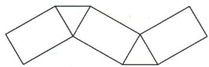

## 课时 2 相反数与绝对值 刷基础

A.圆柱 B.圆锥 C.四棱柱 D.三棱柱

![[初中/课堂同步/教辅/必刷题/2026版《初中必刷题》数学 BS  7上/02_第二章_有理数及其运算/课时_2_相反数与绝对值/questions/Q00097899.md]]
![[初中/课堂同步/教辅/必刷题/2026版《初中必刷题》数学 BS  7上/02_第二章_有理数及其运算/课时_2_相反数与绝对值/questions/Q00097900.md]]
![[初中/课堂同步/教辅/必刷题/2026版《初中必刷题》数学 BS  7上/02_第二章_有理数及其运算/课时_2_相反数与绝对值/questions/Q00097901.md]]
## 知识点 2 圆柱的展开与折叠

![[初中/课堂同步/教辅/必刷题/2026版《初中必刷题》数学 BS  7上/02_第二章_有理数及其运算/课时_2_相反数与绝对值/questions/Q00097902.md]]
![[初中/课堂同步/教辅/必刷题/2026版《初中必刷题》数学 BS  7上/02_第二章_有理数及其运算/课时_2_相反数与绝对值/questions/Q00097903.md]]
## 知识点 3 圆锥、棱锥的展开与折叠

![[初中/课堂同步/教辅/必刷题/2026版《初中必刷题》数学 BS  7上/02_第二章_有理数及其运算/课时_2_相反数与绝对值/questions/Q00097904.md]]
![[初中/课堂同步/教辅/必刷题/2026版《初中必刷题》数学 BS  7上/02_第二章_有理数及其运算/课时_2_相反数与绝对值/questions/Q00097905.md]]
# 课时 3 截一个几何体

## 知识点 1 用平面截一个几何体所得截面的形状
