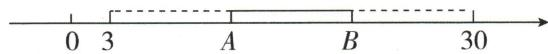
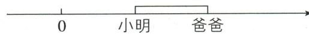

<!-- question-source:start -->
6 核心素养应用意识 [2025 吉林松原期中,较难] 如图(1),将一根木棒放在数轴(单位长度为 1)上,木棒左端与数轴上的点 A 重合,右端与数轴上的点 B 重合.

图(1)

(1)若将木棒沿数轴向右水平移动,则当它的左端移动到点B时,它的右端在数轴上所对应的数为30;若将木棒沿数轴向左水平移动,则当它的右端移动到点A时,它的左端在数轴上所对应的数为3,由此可得这根木棒的长为\_\_\_\_;点A表示的数是\_\_\_\_;点B表示的数是\_\_\_\_.

(2)仿照(1)的方法,请借助“数轴”这个工具解决问题:一天,爸爸对小明说:“我若是你现在这么大,你才刚出生;你若是我现在这么大,我就84岁啦!”则爸爸的年龄是\_\_\_\_岁.
(在图(2)中标出分析过程)

图(2)
<!-- question-source:end -->

![[Q00102153A1]]
