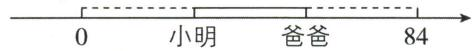

> [!success]- 必刷题
>
> > [!success] **【答案】** 9,12,21
>
> > [!note]- **【解析】**
> > 【解】(1)由题意得三根这样的木棒长为30-3=27,则这根木棒的长为 $27\div3=9$ ,所以点B表示的数是 $3+9+9=21$ ,点A表示的数是 $3+9=12$ .故答案为9,12,21.
> >
> > (2)如图,把小明和爸爸的年龄差看作木棒的长度,同理可得爸爸比小明大 $84\div3=28$ (岁),所以爸爸的年龄是84-28=56(岁).故答案为56.
> >
> > 
> >
> > ## 2 有理数的加减运算
> >
> > ## 课时1 有理数的加法
