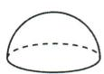
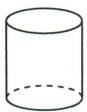
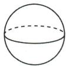
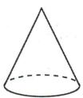
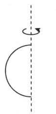
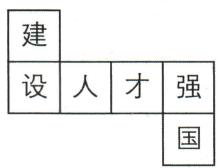

## 课时 3 有理数的减法 刷基础

A

B

C

D

  
(第1题图)

  
(第2题图)

## 考点2 几何体的展开与折叠

![[初中/课堂同步/教辅/必刷题/2026版《初中必刷题》数学 BS  7上/02_第二章_有理数及其运算/课时_3_有理数的减法/questions/Q00097929.md]]
![[初中/课堂同步/教辅/必刷题/2026版《初中必刷题》数学 BS  7上/02_第二章_有理数及其运算/课时_3_有理数的减法/questions/Q00097930.md]]
![[初中/课堂同步/教辅/必刷题/2026版《初中必刷题》数学 BS  7上/02_第二章_有理数及其运算/课时_3_有理数的减法/questions/Q00097931.md]]
![[初中/课堂同步/教辅/必刷题/2026版《初中必刷题》数学 BS  7上/02_第二章_有理数及其运算/课时_3_有理数的减法/questions/Q00097932.md]]
## 考点3 从三个方向看几何体的形状

![[初中/课堂同步/教辅/必刷题/2026版《初中必刷题》数学 BS  7上/02_第二章_有理数及其运算/课时_3_有理数的减法/questions/Q00097933.md]]
![[初中/课堂同步/教辅/必刷题/2026版《初中必刷题》数学 BS  7上/02_第二章_有理数及其运算/课时_3_有理数的减法/questions/Q00097934.md]]
![[初中/课堂同步/教辅/必刷题/2026版《初中必刷题》数学 BS  7上/02_第二章_有理数及其运算/课时_3_有理数的减法/questions/Q00097935.md]]
## 一、选择题(本大题共3小题,每小题8分,共24分)
