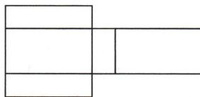

<!-- question-source:start -->
7[2024 江苏泰州姜堰区期末]小明在学习了《从立体图形到平面图形》这一课后,掌握了长方体盒子的制作方法.如图是他制作的一个半成品的平面图.
(1) 在图中补充一个长方形,使该平面图能折叠成一个长方体盒子;
(2) 已知小明制作的长方体盒子长是宽的 2 倍,宽是高的 2 倍,且长方体所有棱长的和为 56 cm,求这个长方体盒子的体积.

<!-- question-source:end -->
