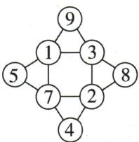
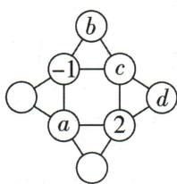
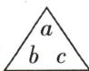

<!-- question-source:start -->
3[2024 湖南长沙期中,较难]“幻方”最早记载于春秋时期的《大戴礼》中,如图(1)所示,每个三角形的三个顶点上的数字之和都与中间正方形四个顶点上的数字之和相等,现将-1,2,-2,-4,5,-5,6,8填入如图(2)所示的“幻方”中,部分数据已填入,则图中 $a+b+c-d$ 的值为()

图(1)

图(2)

A.-5 B.5 C.6 D.-6

<!-- question-source:end -->

![[Q00102209A1]]
