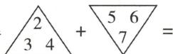

> [!success]- 必刷题
>
> > [!success] **【答案】** -3
>
> > [!note]- **【解析】**
> > 根据题意得 $\begin{array}{cc}2 & 5 \\ 3 & 4 \end{array} + \begin{array}{cc}5 & 6 \\ 7 \end{array} = 2-3+4+(-5+6-7)=2-3+4-5+6-7=-3$ ，故答案为-3.
> >
> > 
