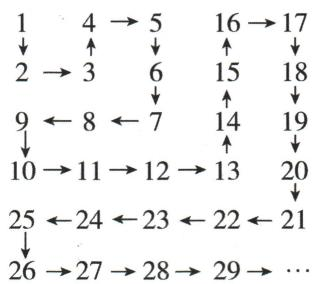

<!-- question-source:start -->
13[2024 山东潍坊中考]将连续的正整数排成如图所示的数表. 记 $a_{(i,j)}$ 为数表中第 $i$ 行第 $j$ 列位置的数字, 如 $a_{(1,2)} = 4, a_{(3,2)} = 8, a_{(5,4)} = 22$ . 若 $a_{(m,n)} = 2024$ , 则 $m = \_$ , $n = \_$ .

<!-- question-source:end -->

![[Q00096429A1]]
