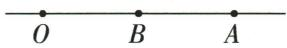

<!-- question-source:start -->
14[2025 河南南阳期末]某中学准备在网上订购一批篮球和跳绳,调查后发现每个篮球的售价为 120 元,每根跳绳的售价为 25 元.现有甲、乙两家网店均提供包邮服务,并提出了各自的优惠方案.

甲网店:买一个篮球送一根跳绳;

乙网店:篮球和跳绳都按定价的90%付款.
已知要购买篮球40个,跳绳x根(x>40).

(1)若在甲网店购买,则需付款\_\_\_\_元.
若在乙网店购买,则需付款\_\_\_\_元.(用含x的代数式表示)

(2) 当 x=80 时, 在哪家网店购买较为合算?
(3) 当 x=80 时, 你认为还有更为省钱的购买方案吗? 如果没有, 请说明理由; 如果有, 请写出你的购买方案, 并计算需要付款的金额.

课时1 线段、射线、直线

电子错题本鸭
<!-- question-source:end -->

![[Q00096443A1]]
