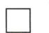
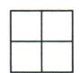
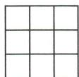
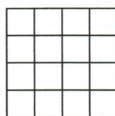

<!-- question-source:start -->
12[2024 山东济宁中考]如图,用大小相等的小正方形按照一定规律拼正方形.第一幅图有1个正方形,第二幅图有5个正方形,第三幅图有14个正方形……按照此规律,第六幅图中正方形的个数为()

第二幅图

第三幅图

第四幅图

B. 91

C. 92

D. 93
<!-- question-source:end -->

![[Q00102936A1]]
