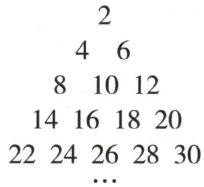

<!-- question-source:start -->
6[2024 四川绵阳中考]如图,将全体正偶数排成一个三角数阵,从上向下数有无数多行,其中第一行有1个数为2,第二行有2个数为4,6,…,第n行有n个数,….探究其中规律,你认为第n行从左至右第3个数不可能是()

A. 36 B. 96 C. 226 D. 426
<!-- question-source:end -->

![[Q00102943A1]]
