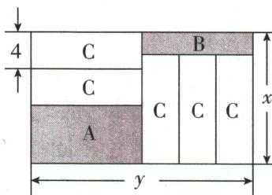
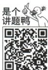

<!-- question-source:start -->
13 如图, 长为 y, 宽为 x 的大长方形被分割成 7 部分, 除阴影图形 A, B 外, 其余 5 部分为形状和大小完全相同的小长方形 C, 其中小长方形 C 的宽为 4.
(1) 计算小长方形 C 的周长 (用含 y 的代数式表示);
(2) 小明发现阴影图形 A 与阴影图形 B 的周长之和与 y 值无关, 请你通过计算对他的发现做出合理解释.

<!-- question-source:end -->

![[Q00102950A1]]
