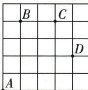

<!-- question-source:start -->
6 思想方法 数形结合 [较难] 如图, 某快递员要从公司 (点 A) 出发, 前往 B, C, D 等地派发包裹, 规定: 向上或向右走记为正, 向下或向左走记为负, 且行走方向顺序为先左右后上下. 例如: 从 A 到 B 记为 $A \rightarrow B (+1, +4)$ , 从 B 到 A 记为 $B \rightarrow A (-1, -4)$ , 其中第一个数表示左右方向走的路程, 第二个数表示上下方向走的路程, 请根据图中 A, B, C, D 的位置信息完成下列问题:

(1) $A \rightarrow C(\_ \_, \_)$ , $B \rightarrow D(\_ \_, \_)$ , $C \rightarrow D(\_ \_, \_)$ ;

(2) 若快递员的行走路线为 $A \rightarrow B \rightarrow C \rightarrow D$ ，请计算该快递员走过的路程；

(3)若快递员从 A 处去 P 处的行走路线依次为 $(+2,+2)$ , $(+1,-1)$ , $(-2,+3)$ , $(-1,-2)$ , 请在图中标出 P 的位置.

<!-- question-source:end -->
