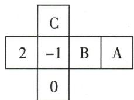
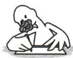

<!-- question-source:start -->
2[2025甘肃陇南期末,中]如图是一个正方体的展开图,若在其中的三个正方形A,B,C内分别填入适当的数,使折成正方体后相对面上的两个数恰好都互为相反数,则A,B,C内的数依次为()

  
刷题先“疯”

A. $1, -2, 0$ B. $-2, 0, 1$ C. $0, -2, 1$ D. $-2, 1, 0$
<!-- question-source:end -->
