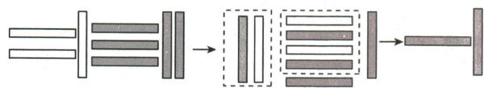
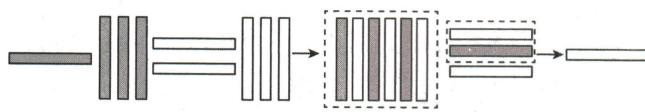

<!-- question-source:start -->
6 新考向传统文化 魏晋时期的数学家刘徽在其著作《九章算术注》中用不同颜色的算筹(小棍形状的记数工具)分别表示正数和负数. 如图(1)表示的是(+21)+(-32)=-11的计算过程(白色为正,灰色为负),则图(2)表示的计算过程是()

  
图(1)

  
图(2)

A. $(-13) + (+23) = +10$ B. $(-31) + (+32) = +1$ C. $(+13) + (+23) = +36$ D. $(+13) + (-23) = -10$
<!-- question-source:end -->
