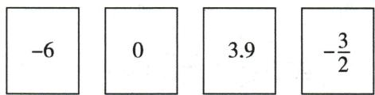

<!-- question-source:start -->
5[2025 河南新乡期中, 中]下面是四张写有不同数字的卡片.

(1) 这四张卡片上的数字中最大的数是\_\_\_\_, 最小的数是\_\_\_\_;

(2)从这四张卡片中随机挑出两张,求这两张卡片上的数字之和的最小值;

(3)从这四张卡片中随机挑出两张,求这两张卡片上的数字之差的最小值.
<!-- question-source:end -->
