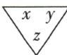

<!-- question-source:start -->
4[2024 湖北十堰期中, 中]我们定义一种新运算, 规定: 图形 $\triangle\begin{array}{cc}a\\b&c\end{array}$ 表示 $a-b+c$ , 图形 $\bigtriangleup\begin{array}{cc}x&y\\z\end{array}$ 表示 $-x+y-z$ , 则 $\bigtriangleup\begin{array}{cc}2\\3&4\end{array}+\bigtriangleup\begin{array}{cc}5&6\\7\end{array}$ 的值为 \_\_\_\_.

<!-- question-source:end -->
