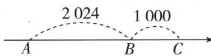

<!-- question-source:start -->
7 思想方法 数形结合 [2025 河南新乡质检, 较难] 数轴是一个非常重要的数学工具, 它使数和数轴上的点建立起一一对应的关系, 揭示了数与点之间的内在联系, 它是“数形结合”的基础. 若点 $P, Q$ 在数轴上分别表示有理数 $p, q$ , 则 $P, Q$ 两点之间的距离可表示为 $PQ = |p - q|$ . 请你利用数形结合的思想回答下列问题:

(1)数轴上表示2和-1的两点之间的距离为\_\_\_\_.

(2)数轴上表示 x 和 -1 的两点之间的距离为 \_\_\_\_.

(3)如图,数轴上从左到右的三个点A,B,C所对应的数分别为a,b,c,其中AB=2024,BC=1000.

①若以点 B 为原点, 写出点 A, C 所对应的数, 并计算 $a + b + c$ 的值;

②若 O 为原点,且 OB=18 ,求 $a+b-c$ 的值.

<!-- question-source:end -->
