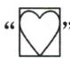
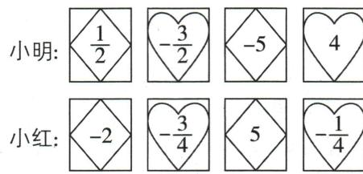

<!-- question-source:start -->
3[2025云南曲靖质检]小明和小红做游戏,游戏规则如下:

①每人抽4张卡片,如果抽到形如“◇”的卡片,那么加上卡片上的数字;如果抽到形如“♡”的卡片,那么减去卡片上的数字.

②比较两人抽4张卡片后的计算结果,结果大的为获胜者.

小明和小红抽到的卡片如图所示,请通过计算说明本次游戏的获胜者是谁.

<!-- question-source:end -->
