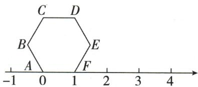

<!-- question-source:start -->
4[2024 广东佛山期末, 中]正六边形 ABCDEF 在数轴上的位置如图, 点 A, F 所对应的数分别为 0 和 1, 若正六边形 ABCDEF 绕着顶点按顺时针方向在数轴上连续翻转, 翻转 1 次后, 点 E 所对应的数为 2, 则连续翻转 2021 次后, 数轴上 2021 这个数对应的是 ( )

A. $A$ 点 B. $B$ 点 C. $C$ 点 D. $D$ 点
<!-- question-source:end -->
