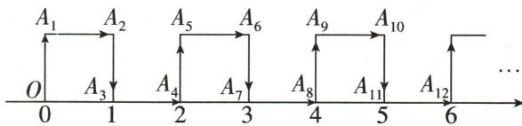

<!-- question-source:start -->
7[2024 山东日照质检, 中]如图, 在纸面所在的平面内, 一只电子蚂蚁从数轴上表示原点的位置 O 点出发, 按向上、向右、向下、向右的方向依次不断移动, 每次移动 1 个单位, 其移动路线如图所示, 第 1 次移动到 $A_{1}$ , 第 2 次移动到 $A_{2}$ , 第 3 次移动到 $A_{3}$ , …, 第 n 次移动到 $A_{n}$ , 则 $\triangle OA_{2}A_{2020}$ 的面积是 ( )

A. $\frac{1009}{2}$ B. 505 C. $\frac{1011}{2}$ D. 506
<!-- question-source:end -->
