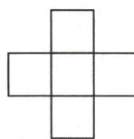

<!-- question-source:start -->
10 新考向开放性试题 [2024 陕西中考 A 卷] 小华探究“幻方”时, 提出了一个问题: 如图, 将 0, -2,

-1,1,2 这五个数分别填在五个小正方形内，使横向三个数之和与纵向三个数之和相等，则填入中间位置的小正方形内的数可以是 \_\_\_\_.（写出一个符合题意的数即可）
<!-- question-source:end -->
