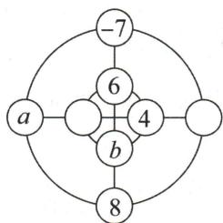

<!-- question-source:start -->
7 小时候大家喜欢玩的幻方游戏,老师稍加创新改成了“幻圆”游戏,现在将-1,2,-3,4,-5,6,-7,8分别填入图中的圆圈内,使横、竖以及内外两圈上的4个数字之和都相等.老师已经帮助同学们完成了部分填空,则图中 $a+b$ 的值为()

A.-6或-3 B.-8或1 C.-1或-4 D.1或-1
<!-- question-source:end -->
