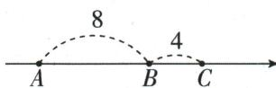

<!-- question-source:start -->
15 如图所示, 在一条不完整的数轴上从左到右有点 A, B, C, 其中 A, B 两点间距离为 8, B, C 两点间距离为 4. 设点 A, B, C 所对应的数之和是 m, 点 A, B, C 所对应的数之积是 n.

(1) 若以 B 为原点, 写出点 A, C 所对应的数, 并计算 m 的值; 若以 C 为原点, m 的值又是多少?

(2) 若原点 $O$ 在图中数轴上点 $C$ 的右边, 且 $C, O$ 两点间距离为 4 , 求 $n$ 的值.

<!-- question-source:end -->
