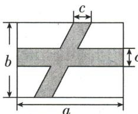

<!-- question-source:start -->
4[2025 福建福州期末]已知买 2 千克苹果共花费 m 元, 则苹果每千克 ( )
A. $\frac{m}{2}$ 元 B. $(m+2)$ 元
C. $(m-2)$ 元 D. 2m 元

$$
a b - b c - a c
$$

$$
b c - a b + a c
$$

$$
b ^ {2} - b c + a ^ {2} - a b
$$

$$
a b - a c - b c + c ^ {2}
$$
<!-- question-source:end -->
