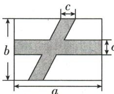

<!-- question-source:start -->
5. 

$$
a b - b c - a c
$$

$$
b c - a b + a c
$$

$$
b ^ {2} - b c + a ^ {2} - a b
$$

$$
a b - a c - b c + c ^ {2}
$$
<!-- question-source:end -->

![[Q00102829A1]]
