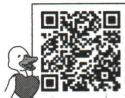

## 课时1 代数式

## 考点1 点、线、面、体

![[初中/课堂同步/教辅/必刷题/2026版《初中必刷题》数学 BS  7上/03_第三章_整式及其加减/课时1_代数式/questions/Q00096040.md]]
## 考点2 几何体的展开与折叠

![[初中/课堂同步/教辅/必刷题/2026版《初中必刷题》数学 BS  7上/03_第三章_整式及其加减/课时1_代数式/questions/Q00096041.md]]
![[初中/课堂同步/教辅/必刷题/2026版《初中必刷题》数学 BS  7上/03_第三章_整式及其加减/课时1_代数式/questions/Q00096042.md]]
![[初中/课堂同步/教辅/必刷题/2026版《初中必刷题》数学 BS  7上/03_第三章_整式及其加减/课时1_代数式/questions/Q00096043.md]]
![[初中/课堂同步/教辅/必刷题/2026版《初中必刷题》数学 BS  7上/03_第三章_整式及其加减/课时1_代数式/questions/Q00096044.md]]
## 考点3 从三个方向看几何体的形状

![[初中/课堂同步/教辅/必刷题/2026版《初中必刷题》数学 BS  7上/03_第三章_整式及其加减/课时1_代数式/questions/Q00096045.md]]
![[初中/课堂同步/教辅/必刷题/2026版《初中必刷题》数学 BS  7上/03_第三章_整式及其加减/课时1_代数式/questions/Q00096046.md]]
![[初中/课堂同步/教辅/必刷题/2026版《初中必刷题》数学 BS  7上/03_第三章_整式及其加减/课时1_代数式/questions/Q00096047.md]]
## 一、选择题(本大题共3小题,每小题8分,共24分)

![[初中/课堂同步/教辅/必刷题/2026版《初中必刷题》数学 BS  7上/03_第三章_整式及其加减/课时1_代数式/questions/Q00096048.md]]
![[初中/课堂同步/教辅/必刷题/2026版《初中必刷题》数学 BS  7上/03_第三章_整式及其加减/课时1_代数式/questions/Q00096049.md]]
![[初中/课堂同步/教辅/必刷题/2026版《初中必刷题》数学 BS  7上/03_第三章_整式及其加减/课时1_代数式/questions/Q00096050.md]]
## 二、填空题(本大题共3小题,每小题8分,共24分)

![[初中/课堂同步/教辅/必刷题/2026版《初中必刷题》数学 BS  7上/03_第三章_整式及其加减/课时1_代数式/questions/Q00096051.md]]
![[初中/课堂同步/教辅/必刷题/2026版《初中必刷题》数学 BS  7上/03_第三章_整式及其加减/课时1_代数式/questions/Q00096052.md]]
![[初中/课堂同步/教辅/必刷题/2026版《初中必刷题》数学 BS  7上/03_第三章_整式及其加减/课时1_代数式/questions/Q00096053.md]]
## 三、解答题(共52分)

![[初中/课堂同步/教辅/必刷题/2026版《初中必刷题》数学 BS  7上/03_第三章_整式及其加减/课时1_代数式/questions/Q00096054.md]]
![[初中/课堂同步/教辅/必刷题/2026版《初中必刷题》数学 BS  7上/03_第三章_整式及其加减/课时1_代数式/questions/Q00096055.md]]
## 知识点 1 具有相反意义的量的表示方法及应用

![[初中/课堂同步/教辅/必刷题/2026版《初中必刷题》数学 BS  7上/03_第三章_整式及其加减/课时1_代数式/questions/Q00096056.md]]
![[初中/课堂同步/教辅/必刷题/2026版《初中必刷题》数学 BS  7上/03_第三章_整式及其加减/课时1_代数式/questions/Q00096057.md]]
![[初中/课堂同步/教辅/必刷题/2026版《初中必刷题》数学 BS  7上/03_第三章_整式及其加减/课时1_代数式/questions/Q00096058.md]]
![[初中/课堂同步/教辅/必刷题/2026版《初中必刷题》数学 BS  7上/03_第三章_整式及其加减/课时1_代数式/questions/Q00096059.md]]
## 知识点 2 正数、负数的概念

![[初中/课堂同步/教辅/必刷题/2026版《初中必刷题》数学 BS  7上/03_第三章_整式及其加减/课时1_代数式/questions/Q00096060.md]]
![[初中/课堂同步/教辅/必刷题/2026版《初中必刷题》数学 BS  7上/03_第三章_整式及其加减/课时1_代数式/questions/Q00096061.md]]
## 知识点 3 有理数的概念及分类

![[初中/课堂同步/教辅/必刷题/2026版《初中必刷题》数学 BS  7上/03_第三章_整式及其加减/课时1_代数式/questions/Q00096062.md]]
![[初中/课堂同步/教辅/必刷题/2026版《初中必刷题》数学 BS  7上/03_第三章_整式及其加减/课时1_代数式/questions/Q00096063.md]]
![[初中/课堂同步/教辅/必刷题/2026版《初中必刷题》数学 BS  7上/03_第三章_整式及其加减/课时1_代数式/questions/Q00096064.md]]
## 2刷易错 小心有坑\~

## 易错点 对 0 的认识不清楚致错

![[初中/课堂同步/教辅/必刷题/2026版《初中必刷题》数学 BS  7上/03_第三章_整式及其加减/课时1_代数式/questions/Q00096065.md]]
![[初中/课堂同步/教辅/必刷题/2026版《初中必刷题》数学 BS  7上/03_第三章_整式及其加减/课时1_代数式/questions/Q00096066.md]]
![[初中/课堂同步/教辅/必刷题/2026版《初中必刷题》数学 BS  7上/03_第三章_整式及其加减/课时1_代数式/questions/Q00096067.md]]
![[初中/课堂同步/教辅/必刷题/2026版《初中必刷题》数学 BS  7上/03_第三章_整式及其加减/课时1_代数式/questions/Q00096068.md]]
![[初中/课堂同步/教辅/必刷题/2026版《初中必刷题》数学 BS  7上/03_第三章_整式及其加减/课时1_代数式/questions/Q00096069.md]]
![[初中/课堂同步/教辅/必刷题/2026版《初中必刷题》数学 BS  7上/03_第三章_整式及其加减/课时1_代数式/questions/Q00096070.md]]
## e刷素养

走向重高

![[初中/课堂同步/教辅/必刷题/2026版《初中必刷题》数学 BS  7上/03_第三章_整式及其加减/课时1_代数式/questions/Q00096071.md]]
# 课时 2 相反数与绝对值

## 知识点 1 相反数的概念

![[初中/课堂同步/教辅/必刷题/2026版《初中必刷题》数学 BS  7上/03_第三章_整式及其加减/课时1_代数式/questions/Q00096072.md]]
![[初中/课堂同步/教辅/必刷题/2026版《初中必刷题》数学 BS  7上/03_第三章_整式及其加减/课时1_代数式/questions/Q00096073.md]]
![[初中/课堂同步/教辅/必刷题/2026版《初中必刷题》数学 BS  7上/03_第三章_整式及其加减/课时1_代数式/questions/Q00096074.md]]
![[初中/课堂同步/教辅/必刷题/2026版《初中必刷题》数学 BS  7上/03_第三章_整式及其加减/课时1_代数式/questions/Q00096075.md]]
## 知识点 2 绝对值的定义及性质

![[初中/课堂同步/教辅/必刷题/2026版《初中必刷题》数学 BS  7上/03_第三章_整式及其加减/课时1_代数式/questions/Q00096076.md]]
![[初中/课堂同步/教辅/必刷题/2026版《初中必刷题》数学 BS  7上/03_第三章_整式及其加减/课时1_代数式/questions/Q00096077.md]]
![[初中/课堂同步/教辅/必刷题/2026版《初中必刷题》数学 BS  7上/03_第三章_整式及其加减/课时1_代数式/questions/Q00096078.md]]
![[初中/课堂同步/教辅/必刷题/2026版《初中必刷题》数学 BS  7上/03_第三章_整式及其加减/课时1_代数式/questions/Q00096079.md]]
![[初中/课堂同步/教辅/必刷题/2026版《初中必刷题》数学 BS  7上/03_第三章_整式及其加减/课时1_代数式/questions/Q00096080.md]]
![[初中/课堂同步/教辅/必刷题/2026版《初中必刷题》数学 BS  7上/03_第三章_整式及其加减/课时1_代数式/questions/Q00096081.md]]
## 知识点 3 比较有理数的大小

![[初中/课堂同步/教辅/必刷题/2026版《初中必刷题》数学 BS  7上/03_第三章_整式及其加减/课时1_代数式/questions/Q00096082.md]]
![[初中/课堂同步/教辅/必刷题/2026版《初中必刷题》数学 BS  7上/03_第三章_整式及其加减/课时1_代数式/questions/Q00096083.md]]
![[初中/课堂同步/教辅/必刷题/2026版《初中必刷题》数学 BS  7上/03_第三章_整式及其加减/课时1_代数式/questions/Q00096084.md]]
## 易错点 对绝对值的性质理解不清致错

![[初中/课堂同步/教辅/必刷题/2026版《初中必刷题》数学 BS  7上/03_第三章_整式及其加减/课时1_代数式/questions/Q00096085.md]]
![[初中/课堂同步/教辅/必刷题/2026版《初中必刷题》数学 BS  7上/03_第三章_整式及其加减/课时1_代数式/questions/Q00096086.md]]
![[初中/课堂同步/教辅/必刷题/2026版《初中必刷题》数学 BS  7上/03_第三章_整式及其加减/课时1_代数式/questions/Q00096087.md]]
![[初中/课堂同步/教辅/必刷题/2026版《初中必刷题》数学 BS  7上/03_第三章_整式及其加减/课时1_代数式/questions/Q00096088.md]]
![[初中/课堂同步/教辅/必刷题/2026版《初中必刷题》数学 BS  7上/03_第三章_整式及其加减/课时1_代数式/questions/Q00096089.md]]
![[初中/课堂同步/教辅/必刷题/2026版《初中必刷题》数学 BS  7上/03_第三章_整式及其加减/课时1_代数式/questions/Q00096090.md]]
![[初中/课堂同步/教辅/必刷题/2026版《初中必刷题》数学 BS  7上/03_第三章_整式及其加减/课时1_代数式/questions/Q00096091.md]]
![[初中/课堂同步/教辅/必刷题/2026版《初中必刷题》数学 BS  7上/03_第三章_整式及其加减/课时1_代数式/questions/Q00096092.md]]
![[初中/课堂同步/教辅/必刷题/2026版《初中必刷题》数学 BS  7上/03_第三章_整式及其加减/课时1_代数式/questions/Q00096093.md]]
# 课时 3 数轴

## 基础

## 知识点 1 数轴的概念与画法

![[初中/课堂同步/教辅/必刷题/2026版《初中必刷题》数学 BS  7上/03_第三章_整式及其加减/课时1_代数式/questions/Q00096094.md]]
![[初中/课堂同步/教辅/必刷题/2026版《初中必刷题》数学 BS  7上/03_第三章_整式及其加减/课时1_代数式/questions/Q00096095.md]]
## 知识点 2 用数轴上的点表示有理数

![[初中/课堂同步/教辅/必刷题/2026版《初中必刷题》数学 BS  7上/03_第三章_整式及其加减/课时1_代数式/questions/Q00096096.md]]
![[初中/课堂同步/教辅/必刷题/2026版《初中必刷题》数学 BS  7上/03_第三章_整式及其加减/课时1_代数式/questions/Q00096097.md]]
![[初中/课堂同步/教辅/必刷题/2026版《初中必刷题》数学 BS  7上/03_第三章_整式及其加减/课时1_代数式/questions/Q00096098.md]]
![[初中/课堂同步/教辅/必刷题/2026版《初中必刷题》数学 BS  7上/03_第三章_整式及其加减/课时1_代数式/questions/Q00096099.md]]
![[初中/课堂同步/教辅/必刷题/2026版《初中必刷题》数学 BS  7上/03_第三章_整式及其加减/课时1_代数式/questions/Q00096100.md]]
![[初中/课堂同步/教辅/必刷题/2026版《初中必刷题》数学 BS  7上/03_第三章_整式及其加减/课时1_代数式/questions/Q00096101.md]]
## 知识点 3 利用数轴比较有理数的大小

![[初中/课堂同步/教辅/必刷题/2026版《初中必刷题》数学 BS  7上/03_第三章_整式及其加减/课时1_代数式/questions/Q00096102.md]]
![[初中/课堂同步/教辅/必刷题/2026版《初中必刷题》数学 BS  7上/03_第三章_整式及其加减/课时1_代数式/questions/Q00096103.md]]
## 2 刷易错 小心有坑\~

## 易错点 在数轴上根据距离求点表示的数时漏解

![[初中/课堂同步/教辅/必刷题/2026版《初中必刷题》数学 BS  7上/03_第三章_整式及其加减/课时1_代数式/questions/Q00096104.md]]
## 刷提升

![[初中/课堂同步/教辅/必刷题/2026版《初中必刷题》数学 BS  7上/03_第三章_整式及其加减/课时1_代数式/questions/Q00096105.md]]
![[初中/课堂同步/教辅/必刷题/2026版《初中必刷题》数学 BS  7上/03_第三章_整式及其加减/课时1_代数式/questions/Q00096106.md]]
![[初中/课堂同步/教辅/必刷题/2026版《初中必刷题》数学 BS  7上/03_第三章_整式及其加减/课时1_代数式/questions/Q00096107.md]]
![[初中/课堂同步/教辅/必刷题/2026版《初中必刷题》数学 BS  7上/03_第三章_整式及其加减/课时1_代数式/questions/Q00096108.md]]
## 微专题1 绝对值最值问题

![[初中/课堂同步/教辅/必刷题/2026版《初中必刷题》数学 BS  7上/03_第三章_整式及其加减/课时1_代数式/questions/Q00096109.md]]
## 刷素养

走向重高

![[初中/课堂同步/教辅/必刷题/2026版《初中必刷题》数学 BS  7上/03_第三章_整式及其加减/课时1_代数式/questions/Q00096110.md]]
# 课时 1 有理数的加法

## 知识点 1 有理数加法法则

![[初中/课堂同步/教辅/必刷题/2026版《初中必刷题》数学 BS  7上/03_第三章_整式及其加减/课时1_代数式/questions/Q00096111.md]]
![[初中/课堂同步/教辅/必刷题/2026版《初中必刷题》数学 BS  7上/03_第三章_整式及其加减/课时1_代数式/questions/Q00096112.md]]
![[初中/课堂同步/教辅/必刷题/2026版《初中必刷题》数学 BS  7上/03_第三章_整式及其加减/课时1_代数式/questions/Q00096113.md]]
![[初中/课堂同步/教辅/必刷题/2026版《初中必刷题》数学 BS  7上/03_第三章_整式及其加减/课时1_代数式/questions/Q00096114.md]]
![[初中/课堂同步/教辅/必刷题/2026版《初中必刷题》数学 BS  7上/03_第三章_整式及其加减/课时1_代数式/questions/Q00096115.md]]
## 知识点 2 有理数加法法则的应用

![[初中/课堂同步/教辅/必刷题/2026版《初中必刷题》数学 BS  7上/03_第三章_整式及其加减/课时1_代数式/questions/Q00096116.md]]
![[初中/课堂同步/教辅/必刷题/2026版《初中必刷题》数学 BS  7上/03_第三章_整式及其加减/课时1_代数式/questions/Q00096117.md]]
![[初中/课堂同步/教辅/必刷题/2026版《初中必刷题》数学 BS  7上/03_第三章_整式及其加减/课时1_代数式/questions/Q00096118.md]]
![[初中/课堂同步/教辅/必刷题/2026版《初中必刷题》数学 BS  7上/03_第三章_整式及其加减/课时1_代数式/questions/Q00096119.md]]
![[初中/课堂同步/教辅/必刷题/2026版《初中必刷题》数学 BS  7上/03_第三章_整式及其加减/课时1_代数式/questions/Q00096120.md]]
![[初中/课堂同步/教辅/必刷题/2026版《初中必刷题》数学 BS  7上/03_第三章_整式及其加减/课时1_代数式/questions/Q00096121.md]]
![[初中/课堂同步/教辅/必刷题/2026版《初中必刷题》数学 BS  7上/03_第三章_整式及其加减/课时1_代数式/questions/Q00096122.md]]
![[初中/课堂同步/教辅/必刷题/2026版《初中必刷题》数学 BS  7上/03_第三章_整式及其加减/课时1_代数式/questions/Q00096123.md]]
![[初中/课堂同步/教辅/必刷题/2026版《初中必刷题》数学 BS  7上/03_第三章_整式及其加减/课时1_代数式/questions/Q00096124.md]]
## 刷素养

走向重高

(1) 比较下列各式的大小(填“>”“<”或“=”): $|5|+|3|$ \_\_\_\_ $|5+3|$ , $|-5|+|-3|$ \_\_\_\_ $|(-5)+(-3)|$ , $|-5|+|3|$ \_\_\_\_ $|-5)+3|$ , $|0|+|-5|$ \_\_\_\_ $|0+(-5)|$ ,
……

(2)通过(1)的比较、观察,请你猜想归纳:
当 a, b 为有理数时, $\left|a\right| + \left|b\right|$ \_\_\_\_ $\left|a + b\right|$ .
(填“≥”“≤”“>”或“<”)

(3)根据(2)中你得出的结论,当 $|x|+|-2|=|x+(-2)|$ 时,直接写出x的取值范围.

扶鸭起来
鸭还能学

# 课时 2 有理数的加法运算律

## 知识点 1 有理数的加法运算律

![[初中/课堂同步/教辅/必刷题/2026版《初中必刷题》数学 BS  7上/03_第三章_整式及其加减/课时1_代数式/questions/Q00096125.md]]
![[初中/课堂同步/教辅/必刷题/2026版《初中必刷题》数学 BS  7上/03_第三章_整式及其加减/课时1_代数式/questions/Q00096126.md]]
![[初中/课堂同步/教辅/必刷题/2026版《初中必刷题》数学 BS  7上/03_第三章_整式及其加减/课时1_代数式/questions/Q00096127.md]]
![[初中/课堂同步/教辅/必刷题/2026版《初中必刷题》数学 BS  7上/03_第三章_整式及其加减/课时1_代数式/questions/Q00096128.md]]
![[初中/课堂同步/教辅/必刷题/2026版《初中必刷题》数学 BS  7上/03_第三章_整式及其加减/课时1_代数式/questions/Q00096129.md]]
![[初中/课堂同步/教辅/必刷题/2026版《初中必刷题》数学 BS  7上/03_第三章_整式及其加减/课时1_代数式/questions/Q00096130.md]]
![[初中/课堂同步/教辅/必刷题/2026版《初中必刷题》数学 BS  7上/03_第三章_整式及其加减/课时1_代数式/questions/Q00096131.md]]
## 知识点 2 有理数加法运算律的实际应用

![[初中/课堂同步/教辅/必刷题/2026版《初中必刷题》数学 BS  7上/03_第三章_整式及其加减/课时1_代数式/questions/Q00096132.md]]
![[初中/课堂同步/教辅/必刷题/2026版《初中必刷题》数学 BS  7上/03_第三章_整式及其加减/课时1_代数式/questions/Q00096133.md]]
## 刷提升

![[初中/课堂同步/教辅/必刷题/2026版《初中必刷题》数学 BS  7上/03_第三章_整式及其加减/课时1_代数式/questions/Q00096134.md]]
![[初中/课堂同步/教辅/必刷题/2026版《初中必刷题》数学 BS  7上/03_第三章_整式及其加减/课时1_代数式/questions/Q00096135.md]]
![[初中/课堂同步/教辅/必刷题/2026版《初中必刷题》数学 BS  7上/03_第三章_整式及其加减/课时1_代数式/questions/Q00096136.md]]
![[初中/课堂同步/教辅/必刷题/2026版《初中必刷题》数学 BS  7上/03_第三章_整式及其加减/课时1_代数式/questions/Q00096137.md]]
![[初中/课堂同步/教辅/必刷题/2026版《初中必刷题》数学 BS  7上/03_第三章_整式及其加减/课时1_代数式/questions/Q00096138.md]]
## 刷素养

走向重高

![[初中/课堂同步/教辅/必刷题/2026版《初中必刷题》数学 BS  7上/03_第三章_整式及其加减/课时1_代数式/questions/Q00096139.md]]
## 知识点 1 有理数减法法则

![[初中/课堂同步/教辅/必刷题/2026版《初中必刷题》数学 BS  7上/03_第三章_整式及其加减/课时1_代数式/questions/Q00096140.md]]
![[初中/课堂同步/教辅/必刷题/2026版《初中必刷题》数学 BS  7上/03_第三章_整式及其加减/课时1_代数式/questions/Q00096141.md]]
![[初中/课堂同步/教辅/必刷题/2026版《初中必刷题》数学 BS  7上/03_第三章_整式及其加减/课时1_代数式/questions/Q00096142.md]]
![[初中/课堂同步/教辅/必刷题/2026版《初中必刷题》数学 BS  7上/03_第三章_整式及其加减/课时1_代数式/questions/Q00096143.md]]
![[初中/课堂同步/教辅/必刷题/2026版《初中必刷题》数学 BS  7上/03_第三章_整式及其加减/课时1_代数式/questions/Q00096144.md]]
## 知识点 2 有理数减法法则的应用

![[初中/课堂同步/教辅/必刷题/2026版《初中必刷题》数学 BS  7上/03_第三章_整式及其加减/课时1_代数式/questions/Q00096145.md]]
![[初中/课堂同步/教辅/必刷题/2026版《初中必刷题》数学 BS  7上/03_第三章_整式及其加减/课时1_代数式/questions/Q00096146.md]]
![[初中/课堂同步/教辅/必刷题/2026版《初中必刷题》数学 BS  7上/03_第三章_整式及其加减/课时1_代数式/questions/Q00096147.md]]
![[初中/课堂同步/教辅/必刷题/2026版《初中必刷题》数学 BS  7上/03_第三章_整式及其加减/课时1_代数式/questions/Q00096148.md]]
## 易错点 对有理数减法法则理解不透致错

![[初中/课堂同步/教辅/必刷题/2026版《初中必刷题》数学 BS  7上/03_第三章_整式及其加减/课时1_代数式/questions/Q00096149.md]]
## 提升

![[初中/课堂同步/教辅/必刷题/2026版《初中必刷题》数学 BS  7上/03_第三章_整式及其加减/课时1_代数式/questions/Q00096150.md]]
![[初中/课堂同步/教辅/必刷题/2026版《初中必刷题》数学 BS  7上/03_第三章_整式及其加减/课时1_代数式/questions/Q00096151.md]]
![[初中/课堂同步/教辅/必刷题/2026版《初中必刷题》数学 BS  7上/03_第三章_整式及其加减/课时1_代数式/questions/Q00096152.md]]
![[初中/课堂同步/教辅/必刷题/2026版《初中必刷题》数学 BS  7上/03_第三章_整式及其加减/课时1_代数式/questions/Q00096153.md]]
![[初中/课堂同步/教辅/必刷题/2026版《初中必刷题》数学 BS  7上/03_第三章_整式及其加减/课时1_代数式/questions/Q00096154.md]]
## e刷素养

走向重高

![[初中/课堂同步/教辅/必刷题/2026版《初中必刷题》数学 BS  7上/03_第三章_整式及其加减/课时1_代数式/questions/Q00096155.md]]
# 课时4 有理数的加减混合运算

## 知识点 有理数的加减混合运算

![[初中/课堂同步/教辅/必刷题/2026版《初中必刷题》数学 BS  7上/03_第三章_整式及其加减/课时1_代数式/questions/Q00096156.md]]
![[初中/课堂同步/教辅/必刷题/2026版《初中必刷题》数学 BS  7上/03_第三章_整式及其加减/课时1_代数式/questions/Q00096157.md]]
![[初中/课堂同步/教辅/必刷题/2026版《初中必刷题》数学 BS  7上/03_第三章_整式及其加减/课时1_代数式/questions/Q00096158.md]]
![[初中/课堂同步/教辅/必刷题/2026版《初中必刷题》数学 BS  7上/03_第三章_整式及其加减/课时1_代数式/questions/Q00096159.md]]
![[初中/课堂同步/教辅/必刷题/2026版《初中必刷题》数学 BS  7上/03_第三章_整式及其加减/课时1_代数式/questions/Q00096160.md]]
![[初中/课堂同步/教辅/必刷题/2026版《初中必刷题》数学 BS  7上/03_第三章_整式及其加减/课时1_代数式/questions/Q00096161.md]]
![[初中/课堂同步/教辅/必刷题/2026版《初中必刷题》数学 BS  7上/03_第三章_整式及其加减/课时1_代数式/questions/Q00096162.md]]
## 易错点 运用运算律交换位置时，易弄错符号

![[初中/课堂同步/教辅/必刷题/2026版《初中必刷题》数学 BS  7上/03_第三章_整式及其加减/课时1_代数式/questions/Q00096163.md]]
## 提升

![[初中/课堂同步/教辅/必刷题/2026版《初中必刷题》数学 BS  7上/03_第三章_整式及其加减/课时1_代数式/questions/Q00096164.md]]
![[初中/课堂同步/教辅/必刷题/2026版《初中必刷题》数学 BS  7上/03_第三章_整式及其加减/课时1_代数式/questions/Q00096165.md]]
![[初中/课堂同步/教辅/必刷题/2026版《初中必刷题》数学 BS  7上/03_第三章_整式及其加减/课时1_代数式/questions/Q00096166.md]]
![[初中/课堂同步/教辅/必刷题/2026版《初中必刷题》数学 BS  7上/03_第三章_整式及其加减/课时1_代数式/questions/Q00096167.md]]
![[初中/课堂同步/教辅/必刷题/2026版《初中必刷题》数学 BS  7上/03_第三章_整式及其加减/课时1_代数式/questions/Q00096168.md]]
![[初中/课堂同步/教辅/必刷题/2026版《初中必刷题》数学 BS  7上/03_第三章_整式及其加减/课时1_代数式/questions/Q00096169.md]]
## 刷素养

走向重高

![[初中/课堂同步/教辅/必刷题/2026版《初中必刷题》数学 BS  7上/03_第三章_整式及其加减/课时1_代数式/questions/Q00096170.md]]
# 课时 5 有理数加减混合运算的实际应用

## 知识点 有理数加减混合运算的实际应用

![[初中/课堂同步/教辅/必刷题/2026版《初中必刷题》数学 BS  7上/03_第三章_整式及其加减/课时1_代数式/questions/Q00096171.md]]
![[初中/课堂同步/教辅/必刷题/2026版《初中必刷题》数学 BS  7上/03_第三章_整式及其加减/课时1_代数式/questions/Q00096172.md]]
![[初中/课堂同步/教辅/必刷题/2026版《初中必刷题》数学 BS  7上/03_第三章_整式及其加减/课时1_代数式/questions/Q00096173.md]]
![[初中/课堂同步/教辅/必刷题/2026版《初中必刷题》数学 BS  7上/03_第三章_整式及其加减/课时1_代数式/questions/Q00096174.md]]
![[初中/课堂同步/教辅/必刷题/2026版《初中必刷题》数学 BS  7上/03_第三章_整式及其加减/课时1_代数式/questions/Q00096175.md]]
# 课时1 有理数的乘法

电子错题本鸭

## 知识点 1 有理数的乘法

![[初中/课堂同步/教辅/必刷题/2026版《初中必刷题》数学 BS  7上/03_第三章_整式及其加减/课时1_代数式/questions/Q00096176.md]]
![[初中/课堂同步/教辅/必刷题/2026版《初中必刷题》数学 BS  7上/03_第三章_整式及其加减/课时1_代数式/questions/Q00096177.md]]
![[初中/课堂同步/教辅/必刷题/2026版《初中必刷题》数学 BS  7上/03_第三章_整式及其加减/课时1_代数式/questions/Q00096178.md]]
![[初中/课堂同步/教辅/必刷题/2026版《初中必刷题》数学 BS  7上/03_第三章_整式及其加减/课时1_代数式/questions/Q00096179.md]]
![[初中/课堂同步/教辅/必刷题/2026版《初中必刷题》数学 BS  7上/03_第三章_整式及其加减/课时1_代数式/questions/Q00096180.md]]
![[初中/课堂同步/教辅/必刷题/2026版《初中必刷题》数学 BS  7上/03_第三章_整式及其加减/课时1_代数式/questions/Q00096181.md]]
![[初中/课堂同步/教辅/必刷题/2026版《初中必刷题》数学 BS  7上/03_第三章_整式及其加减/课时1_代数式/questions/Q00096182.md]]
![[初中/课堂同步/教辅/必刷题/2026版《初中必刷题》数学 BS  7上/03_第三章_整式及其加减/课时1_代数式/questions/Q00096183.md]]
## 知识点 2 倒数

![[初中/课堂同步/教辅/必刷题/2026版《初中必刷题》数学 BS  7上/03_第三章_整式及其加减/课时1_代数式/questions/Q00096184.md]]
![[初中/课堂同步/教辅/必刷题/2026版《初中必刷题》数学 BS  7上/03_第三章_整式及其加减/课时1_代数式/questions/Q00096185.md]]
![[初中/课堂同步/教辅/必刷题/2026版《初中必刷题》数学 BS  7上/03_第三章_整式及其加减/课时1_代数式/questions/Q00096186.md]]
![[初中/课堂同步/教辅/必刷题/2026版《初中必刷题》数学 BS  7上/03_第三章_整式及其加减/课时1_代数式/questions/Q00096187.md]]
![[初中/课堂同步/教辅/必刷题/2026版《初中必刷题》数学 BS  7上/03_第三章_整式及其加减/课时1_代数式/questions/Q00096188.md]]
![[初中/课堂同步/教辅/必刷题/2026版《初中必刷题》数学 BS  7上/03_第三章_整式及其加减/课时1_代数式/questions/Q00096189.md]]
![[初中/课堂同步/教辅/必刷题/2026版《初中必刷题》数学 BS  7上/03_第三章_整式及其加减/课时1_代数式/questions/Q00096190.md]]
![[初中/课堂同步/教辅/必刷题/2026版《初中必刷题》数学 BS  7上/03_第三章_整式及其加减/课时1_代数式/questions/Q00096191.md]]
![[初中/课堂同步/教辅/必刷题/2026版《初中必刷题》数学 BS  7上/03_第三章_整式及其加减/课时1_代数式/questions/Q00096192.md]]
## 刷素养

走向重高

![[初中/课堂同步/教辅/必刷题/2026版《初中必刷题》数学 BS  7上/03_第三章_整式及其加减/课时1_代数式/questions/Q00096193.md]]
# 课时 2 有理数的乘法运算律

## 知识点 1 多个有理数相乘

![[初中/课堂同步/教辅/必刷题/2026版《初中必刷题》数学 BS  7上/03_第三章_整式及其加减/课时1_代数式/questions/Q00096194.md]]
![[初中/课堂同步/教辅/必刷题/2026版《初中必刷题》数学 BS  7上/03_第三章_整式及其加减/课时1_代数式/questions/Q00096195.md]]
![[初中/课堂同步/教辅/必刷题/2026版《初中必刷题》数学 BS  7上/03_第三章_整式及其加减/课时1_代数式/questions/Q00096196.md]]
![[初中/课堂同步/教辅/必刷题/2026版《初中必刷题》数学 BS  7上/03_第三章_整式及其加减/课时1_代数式/questions/Q00096197.md]]
![[初中/课堂同步/教辅/必刷题/2026版《初中必刷题》数学 BS  7上/03_第三章_整式及其加减/课时1_代数式/questions/Q00096198.md]]
![[初中/课堂同步/教辅/必刷题/2026版《初中必刷题》数学 BS  7上/03_第三章_整式及其加减/课时1_代数式/questions/Q00096199.md]]
## 知识点 2 有理数的乘法运算律

![[初中/课堂同步/教辅/必刷题/2026版《初中必刷题》数学 BS  7上/03_第三章_整式及其加减/课时1_代数式/questions/Q00096200.md]]
![[初中/课堂同步/教辅/必刷题/2026版《初中必刷题》数学 BS  7上/03_第三章_整式及其加减/课时1_代数式/questions/Q00096201.md]]
![[初中/课堂同步/教辅/必刷题/2026版《初中必刷题》数学 BS  7上/03_第三章_整式及其加减/课时1_代数式/questions/Q00096202.md]]
![[初中/课堂同步/教辅/必刷题/2026版《初中必刷题》数学 BS  7上/03_第三章_整式及其加减/课时1_代数式/questions/Q00096203.md]]
## 易错点 应用乘法对加法的分配律计算时，出现漏乘或符号错误

![[初中/课堂同步/教辅/必刷题/2026版《初中必刷题》数学 BS  7上/03_第三章_整式及其加减/课时1_代数式/questions/Q00096204.md]]
![[初中/课堂同步/教辅/必刷题/2026版《初中必刷题》数学 BS  7上/03_第三章_整式及其加减/课时1_代数式/questions/Q00096205.md]]
![[初中/课堂同步/教辅/必刷题/2026版《初中必刷题》数学 BS  7上/03_第三章_整式及其加减/课时1_代数式/questions/Q00096206.md]]
![[初中/课堂同步/教辅/必刷题/2026版《初中必刷题》数学 BS  7上/03_第三章_整式及其加减/课时1_代数式/questions/Q00096207.md]]
![[初中/课堂同步/教辅/必刷题/2026版《初中必刷题》数学 BS  7上/03_第三章_整式及其加减/课时1_代数式/questions/Q00096208.md]]
## 刷素养

走向重高

![[初中/课堂同步/教辅/必刷题/2026版《初中必刷题》数学 BS  7上/03_第三章_整式及其加减/课时1_代数式/questions/Q00096209.md]]
# 课时 3 有理数的除法

## 知识点 1 有理数的除法法则

![[初中/课堂同步/教辅/必刷题/2026版《初中必刷题》数学 BS  7上/03_第三章_整式及其加减/课时1_代数式/questions/Q00096210.md]]
![[初中/课堂同步/教辅/必刷题/2026版《初中必刷题》数学 BS  7上/03_第三章_整式及其加减/课时1_代数式/questions/Q00096211.md]]
![[初中/课堂同步/教辅/必刷题/2026版《初中必刷题》数学 BS  7上/03_第三章_整式及其加减/课时1_代数式/questions/Q00096212.md]]
![[初中/课堂同步/教辅/必刷题/2026版《初中必刷题》数学 BS  7上/03_第三章_整式及其加减/课时1_代数式/questions/Q00096213.md]]
![[初中/课堂同步/教辅/必刷题/2026版《初中必刷题》数学 BS  7上/03_第三章_整式及其加减/课时1_代数式/questions/Q00096214.md]]
![[初中/课堂同步/教辅/必刷题/2026版《初中必刷题》数学 BS  7上/03_第三章_整式及其加减/课时1_代数式/questions/Q00096215.md]]
## 知识点 2 有理数的除法法则的实际应用

![[初中/课堂同步/教辅/必刷题/2026版《初中必刷题》数学 BS  7上/03_第三章_整式及其加减/课时1_代数式/questions/Q00096216.md]]
![[初中/课堂同步/教辅/必刷题/2026版《初中必刷题》数学 BS  7上/03_第三章_整式及其加减/课时1_代数式/questions/Q00096217.md]]
## 易错点 误认为乘法对加法的分配律可以用于有理数的除法

![[初中/课堂同步/教辅/必刷题/2026版《初中必刷题》数学 BS  7上/03_第三章_整式及其加减/课时1_代数式/questions/Q00096218.md]]
![[初中/课堂同步/教辅/必刷题/2026版《初中必刷题》数学 BS  7上/03_第三章_整式及其加减/课时1_代数式/questions/Q00096219.md]]
![[初中/课堂同步/教辅/必刷题/2026版《初中必刷题》数学 BS  7上/03_第三章_整式及其加减/课时1_代数式/questions/Q00096220.md]]
![[初中/课堂同步/教辅/必刷题/2026版《初中必刷题》数学 BS  7上/03_第三章_整式及其加减/课时1_代数式/questions/Q00096221.md]]
![[初中/课堂同步/教辅/必刷题/2026版《初中必刷题》数学 BS  7上/03_第三章_整式及其加减/课时1_代数式/questions/Q00096222.md]]
![[初中/课堂同步/教辅/必刷题/2026版《初中必刷题》数学 BS  7上/03_第三章_整式及其加减/课时1_代数式/questions/Q00096223.md]]
## 刷素养 走向重高

![[初中/课堂同步/教辅/必刷题/2026版《初中必刷题》数学 BS  7上/03_第三章_整式及其加减/课时1_代数式/questions/Q00096224.md]]
## 基础

## 知识点 1 乘方的概念

![[初中/课堂同步/教辅/必刷题/2026版《初中必刷题》数学 BS  7上/03_第三章_整式及其加减/课时1_代数式/questions/Q00096225.md]]
![[初中/课堂同步/教辅/必刷题/2026版《初中必刷题》数学 BS  7上/03_第三章_整式及其加减/课时1_代数式/questions/Q00096226.md]]
![[初中/课堂同步/教辅/必刷题/2026版《初中必刷题》数学 BS  7上/03_第三章_整式及其加减/课时1_代数式/questions/Q00096227.md]]
## 知识点 2 乘方的运算

![[初中/课堂同步/教辅/必刷题/2026版《初中必刷题》数学 BS  7上/03_第三章_整式及其加减/课时1_代数式/questions/Q00096228.md]]
![[初中/课堂同步/教辅/必刷题/2026版《初中必刷题》数学 BS  7上/03_第三章_整式及其加减/课时1_代数式/questions/Q00096229.md]]
![[初中/课堂同步/教辅/必刷题/2026版《初中必刷题》数学 BS  7上/03_第三章_整式及其加减/课时1_代数式/questions/Q00096230.md]]
![[初中/课堂同步/教辅/必刷题/2026版《初中必刷题》数学 BS  7上/03_第三章_整式及其加减/课时1_代数式/questions/Q00096231.md]]
## 知识点 3 乘方的实际应用

![[初中/课堂同步/教辅/必刷题/2026版《初中必刷题》数学 BS  7上/03_第三章_整式及其加减/课时1_代数式/questions/Q00096232.md]]
![[初中/课堂同步/教辅/必刷题/2026版《初中必刷题》数学 BS  7上/03_第三章_整式及其加减/课时1_代数式/questions/Q00096233.md]]
![[初中/课堂同步/教辅/必刷题/2026版《初中必刷题》数学 BS  7上/03_第三章_整式及其加减/课时1_代数式/questions/Q00096234.md]]
## 易错点 对 $(-a)^n$ 与 $-a^n$ 理解不清而致错

![[初中/课堂同步/教辅/必刷题/2026版《初中必刷题》数学 BS  7上/03_第三章_整式及其加减/课时1_代数式/questions/Q00096235.md]]
# 课时 2 科学记数法

## 知识点 1 用科学记数法表示较大的数

![[初中/课堂同步/教辅/必刷题/2026版《初中必刷题》数学 BS  7上/03_第三章_整式及其加减/课时1_代数式/questions/Q00096236.md]]
![[初中/课堂同步/教辅/必刷题/2026版《初中必刷题》数学 BS  7上/03_第三章_整式及其加减/课时1_代数式/questions/Q00096237.md]]
![[初中/课堂同步/教辅/必刷题/2026版《初中必刷题》数学 BS  7上/03_第三章_整式及其加减/课时1_代数式/questions/Q00096238.md]]
![[初中/课堂同步/教辅/必刷题/2026版《初中必刷题》数学 BS  7上/03_第三章_整式及其加减/课时1_代数式/questions/Q00096239.md]]
![[初中/课堂同步/教辅/必刷题/2026版《初中必刷题》数学 BS  7上/03_第三章_整式及其加减/课时1_代数式/questions/Q00096240.md]]
![[初中/课堂同步/教辅/必刷题/2026版《初中必刷题》数学 BS  7上/03_第三章_整式及其加减/课时1_代数式/questions/Q00096241.md]]
## 知识点 2 将用科学记数法表示的数还原

![[初中/课堂同步/教辅/必刷题/2026版《初中必刷题》数学 BS  7上/03_第三章_整式及其加减/课时1_代数式/questions/Q00096242.md]]
![[初中/课堂同步/教辅/必刷题/2026版《初中必刷题》数学 BS  7上/03_第三章_整式及其加减/课时1_代数式/questions/Q00096243.md]]
![[初中/课堂同步/教辅/必刷题/2026版《初中必刷题》数学 BS  7上/03_第三章_整式及其加减/课时1_代数式/questions/Q00096244.md]]
## 知识点 有理数的混合运算

![[初中/课堂同步/教辅/必刷题/2026版《初中必刷题》数学 BS  7上/03_第三章_整式及其加减/课时1_代数式/questions/Q00096245.md]]
![[初中/课堂同步/教辅/必刷题/2026版《初中必刷题》数学 BS  7上/03_第三章_整式及其加减/课时1_代数式/questions/Q00096246.md]]
![[初中/课堂同步/教辅/必刷题/2026版《初中必刷题》数学 BS  7上/03_第三章_整式及其加减/课时1_代数式/questions/Q00096247.md]]
![[初中/课堂同步/教辅/必刷题/2026版《初中必刷题》数学 BS  7上/03_第三章_整式及其加减/课时1_代数式/questions/Q00096248.md]]
![[初中/课堂同步/教辅/必刷题/2026版《初中必刷题》数学 BS  7上/03_第三章_整式及其加减/课时1_代数式/questions/Q00096249.md]]
![[初中/课堂同步/教辅/必刷题/2026版《初中必刷题》数学 BS  7上/03_第三章_整式及其加减/课时1_代数式/questions/Q00096250.md]]
![[初中/课堂同步/教辅/必刷题/2026版《初中必刷题》数学 BS  7上/03_第三章_整式及其加减/课时1_代数式/questions/Q00096251.md]]
![[初中/课堂同步/教辅/必刷题/2026版《初中必刷题》数学 BS  7上/03_第三章_整式及其加减/课时1_代数式/questions/Q00096252.md]]
![[初中/课堂同步/教辅/必刷题/2026版《初中必刷题》数学 BS  7上/03_第三章_整式及其加减/课时1_代数式/questions/Q00096253.md]]
![[初中/课堂同步/教辅/必刷题/2026版《初中必刷题》数学 BS  7上/03_第三章_整式及其加减/课时1_代数式/questions/Q00096254.md]]
![[初中/课堂同步/教辅/必刷题/2026版《初中必刷题》数学 BS  7上/03_第三章_整式及其加减/课时1_代数式/questions/Q00096255.md]]
![[初中/课堂同步/教辅/必刷题/2026版《初中必刷题》数学 BS  7上/03_第三章_整式及其加减/课时1_代数式/questions/Q00096256.md]]
![[初中/课堂同步/教辅/必刷题/2026版《初中必刷题》数学 BS  7上/03_第三章_整式及其加减/课时1_代数式/questions/Q00096257.md]]
![[初中/课堂同步/教辅/必刷题/2026版《初中必刷题》数学 BS  7上/03_第三章_整式及其加减/课时1_代数式/questions/Q00096258.md]]
![[初中/课堂同步/教辅/必刷题/2026版《初中必刷题》数学 BS  7上/03_第三章_整式及其加减/课时1_代数式/questions/Q00096259.md]]
![[初中/课堂同步/教辅/必刷题/2026版《初中必刷题》数学 BS  7上/03_第三章_整式及其加减/课时1_代数式/questions/Q00096260.md]]
![[初中/课堂同步/教辅/必刷题/2026版《初中必刷题》数学 BS  7上/03_第三章_整式及其加减/课时1_代数式/questions/Q00096261.md]]
![[初中/课堂同步/教辅/必刷题/2026版《初中必刷题》数学 BS  7上/03_第三章_整式及其加减/课时1_代数式/questions/Q00096262.md]]
## 刷素养

走向重高

![[初中/课堂同步/教辅/必刷题/2026版《初中必刷题》数学 BS  7上/03_第三章_整式及其加减/课时1_代数式/questions/Q00096263.md]]
# 课时 2 用计算器进行运算

## 知识点 1 计算器的基本操作

下列说法错误的是 ( )
A. 开启计算器使之工作的按键是ON键
B. 输入-5.8的顺序是(-)5.8
C. 输入0.58的按键顺序是0.58
D. 按键69-87EXE能计算出-69-87的结果

![[初中/课堂同步/教辅/必刷题/2026版《初中必刷题》数学 BS  7上/03_第三章_整式及其加减/课时1_代数式/questions/Q00096264.md]]
![[初中/课堂同步/教辅/必刷题/2026版《初中必刷题》数学 BS  7上/03_第三章_整式及其加减/课时1_代数式/questions/Q00096265.md]]
![[初中/课堂同步/教辅/必刷题/2026版《初中必刷题》数学 BS  7上/03_第三章_整式及其加减/课时1_代数式/questions/Q00096266.md]]
## 知识点 2 近似数与精确度

![[初中/课堂同步/教辅/必刷题/2026版《初中必刷题》数学 BS  7上/03_第三章_整式及其加减/课时1_代数式/questions/Q00096267.md]]
![[初中/课堂同步/教辅/必刷题/2026版《初中必刷题》数学 BS  7上/03_第三章_整式及其加减/课时1_代数式/questions/Q00096268.md]]
![[初中/课堂同步/教辅/必刷题/2026版《初中必刷题》数学 BS  7上/03_第三章_整式及其加减/课时1_代数式/questions/Q00096269.md]]
![[初中/课堂同步/教辅/必刷题/2026版《初中必刷题》数学 BS  7上/03_第三章_整式及其加减/课时1_代数式/questions/Q00096270.md]]
![[初中/课堂同步/教辅/必刷题/2026版《初中必刷题》数学 BS  7上/03_第三章_整式及其加减/课时1_代数式/questions/Q00096271.md]]
![[初中/课堂同步/教辅/必刷题/2026版《初中必刷题》数学 BS  7上/03_第三章_整式及其加减/课时1_代数式/questions/Q00096272.md]]
![[初中/课堂同步/教辅/必刷题/2026版《初中必刷题》数学 BS  7上/03_第三章_整式及其加减/课时1_代数式/questions/Q00096273.md]]
## 类型 1 归类组合法

![[初中/课堂同步/教辅/必刷题/2026版《初中必刷题》数学 BS  7上/03_第三章_整式及其加减/课时1_代数式/questions/Q00096274.md]]
## 类型 2 逆用乘法对加法的分配律

![[初中/课堂同步/教辅/必刷题/2026版《初中必刷题》数学 BS  7上/03_第三章_整式及其加减/课时1_代数式/questions/Q00096275.md]]
![[初中/课堂同步/教辅/必刷题/2026版《初中必刷题》数学 BS  7上/03_第三章_整式及其加减/课时1_代数式/questions/Q00096276.md]]
![[初中/课堂同步/教辅/必刷题/2026版《初中必刷题》数学 BS  7上/03_第三章_整式及其加减/课时1_代数式/questions/Q00096277.md]]
![[初中/课堂同步/教辅/必刷题/2026版《初中必刷题》数学 BS  7上/03_第三章_整式及其加减/课时1_代数式/questions/Q00096278.md]]
## 类型 3 凑整法

![[初中/课堂同步/教辅/必刷题/2026版《初中必刷题》数学 BS  7上/03_第三章_整式及其加减/课时1_代数式/questions/Q00096279.md]]
## 类型 4 分组搭配法

![[初中/课堂同步/教辅/必刷题/2026版《初中必刷题》数学 BS  7上/03_第三章_整式及其加减/课时1_代数式/questions/Q00096280.md]]
## 类型 5 拆项法

![[初中/课堂同步/教辅/必刷题/2026版《初中必刷题》数学 BS  7上/03_第三章_整式及其加减/课时1_代数式/questions/Q00096281.md]]
## 类型 6 倒数法

![[初中/课堂同步/教辅/必刷题/2026版《初中必刷题》数学 BS  7上/03_第三章_整式及其加减/课时1_代数式/questions/Q00096282.md]]
## 类型 7 倒序相加法

![[初中/课堂同步/教辅/必刷题/2026版《初中必刷题》数学 BS  7上/03_第三章_整式及其加减/课时1_代数式/questions/Q00096283.md]]
![[初中/课堂同步/教辅/必刷题/2026版《初中必刷题》数学 BS  7上/03_第三章_整式及其加减/课时1_代数式/questions/Q00096284.md]]
## 母题学大招 1 数轴中的折叠问题

![[初中/课堂同步/教辅/必刷题/2026版《初中必刷题》数学 BS  7上/03_第三章_整式及其加减/课时1_代数式/questions/Q00096285.md]]
## 子题练变式

![[初中/课堂同步/教辅/必刷题/2026版《初中必刷题》数学 BS  7上/03_第三章_整式及其加减/课时1_代数式/questions/Q00096286.md]]
![[初中/课堂同步/教辅/必刷题/2026版《初中必刷题》数学 BS  7上/03_第三章_整式及其加减/课时1_代数式/questions/Q00096287.md]]
## 母题学大招2 数轴上循环规律问题

![[初中/课堂同步/教辅/必刷题/2026版《初中必刷题》数学 BS  7上/03_第三章_整式及其加减/课时1_代数式/questions/Q00096288.md]]
## 子题练变式

![[初中/课堂同步/教辅/必刷题/2026版《初中必刷题》数学 BS  7上/03_第三章_整式及其加减/课时1_代数式/questions/Q00096289.md]]
## 母题学大招 3 数轴上数的变化规律问题

![[初中/课堂同步/教辅/必刷题/2026版《初中必刷题》数学 BS  7上/03_第三章_整式及其加减/课时1_代数式/questions/Q00096290.md]]
## c 子题练变式

![[初中/课堂同步/教辅/必刷题/2026版《初中必刷题》数学 BS  7上/03_第三章_整式及其加减/课时1_代数式/questions/Q00096291.md]]
# 全章综合训练

  
是个新“烤”鸭

  
电子错题本鸭

## 考点1 认识有理数

![[初中/课堂同步/教辅/必刷题/2026版《初中必刷题》数学 BS  7上/03_第三章_整式及其加减/课时1_代数式/questions/Q00096292.md]]
![[初中/课堂同步/教辅/必刷题/2026版《初中必刷题》数学 BS  7上/03_第三章_整式及其加减/课时1_代数式/questions/Q00096293.md]]
![[初中/课堂同步/教辅/必刷题/2026版《初中必刷题》数学 BS  7上/03_第三章_整式及其加减/课时1_代数式/questions/Q00096294.md]]
## 考点2 数轴

建议用时-25分钟

![[初中/课堂同步/教辅/必刷题/2026版《初中必刷题》数学 BS  7上/03_第三章_整式及其加减/课时1_代数式/questions/Q00096295.md]]
![[初中/课堂同步/教辅/必刷题/2026版《初中必刷题》数学 BS  7上/03_第三章_整式及其加减/课时1_代数式/questions/Q00096296.md]]
## 考点 3 有理数的运算

![[初中/课堂同步/教辅/必刷题/2026版《初中必刷题》数学 BS  7上/03_第三章_整式及其加减/课时1_代数式/questions/Q00096297.md]]
![[初中/课堂同步/教辅/必刷题/2026版《初中必刷题》数学 BS  7上/03_第三章_整式及其加减/课时1_代数式/questions/Q00096298.md]]
![[初中/课堂同步/教辅/必刷题/2026版《初中必刷题》数学 BS  7上/03_第三章_整式及其加减/课时1_代数式/questions/Q00096299.md]]
![[初中/课堂同步/教辅/必刷题/2026版《初中必刷题》数学 BS  7上/03_第三章_整式及其加减/课时1_代数式/questions/Q00096300.md]]
![[初中/课堂同步/教辅/必刷题/2026版《初中必刷题》数学 BS  7上/03_第三章_整式及其加减/课时1_代数式/questions/Q00096301.md]]
![[初中/课堂同步/教辅/必刷题/2026版《初中必刷题》数学 BS  7上/03_第三章_整式及其加减/课时1_代数式/questions/Q00096302.md]]
![[初中/课堂同步/教辅/必刷题/2026版《初中必刷题》数学 BS  7上/03_第三章_整式及其加减/课时1_代数式/questions/Q00096303.md]]
## 考点4 科学记数法

![[初中/课堂同步/教辅/必刷题/2026版《初中必刷题》数学 BS  7上/03_第三章_整式及其加减/课时1_代数式/questions/Q00096304.md]]
## 一、选择题(本大题共7小题,每小题4分,共28分)

![[初中/课堂同步/教辅/必刷题/2026版《初中必刷题》数学 BS  7上/03_第三章_整式及其加减/课时1_代数式/questions/Q00096305.md]]
![[初中/课堂同步/教辅/必刷题/2026版《初中必刷题》数学 BS  7上/03_第三章_整式及其加减/课时1_代数式/questions/Q00096306.md]]
![[初中/课堂同步/教辅/必刷题/2026版《初中必刷题》数学 BS  7上/03_第三章_整式及其加减/课时1_代数式/questions/Q00096307.md]]
![[初中/课堂同步/教辅/必刷题/2026版《初中必刷题》数学 BS  7上/03_第三章_整式及其加减/课时1_代数式/questions/Q00096308.md]]
![[初中/课堂同步/教辅/必刷题/2026版《初中必刷题》数学 BS  7上/03_第三章_整式及其加减/课时1_代数式/questions/Q00096309.md]]
![[初中/课堂同步/教辅/必刷题/2026版《初中必刷题》数学 BS  7上/03_第三章_整式及其加减/课时1_代数式/questions/Q00096310.md]]
![[初中/课堂同步/教辅/必刷题/2026版《初中必刷题》数学 BS  7上/03_第三章_整式及其加减/课时1_代数式/questions/Q00096311.md]]
## 二、填空题(本大题共5小题,每小题4分,共20分)

![[初中/课堂同步/教辅/必刷题/2026版《初中必刷题》数学 BS  7上/03_第三章_整式及其加减/课时1_代数式/questions/Q00096312.md]]
![[初中/课堂同步/教辅/必刷题/2026版《初中必刷题》数学 BS  7上/03_第三章_整式及其加减/课时1_代数式/questions/Q00096313.md]]
![[初中/课堂同步/教辅/必刷题/2026版《初中必刷题》数学 BS  7上/03_第三章_整式及其加减/课时1_代数式/questions/Q00096314.md]]
![[初中/课堂同步/教辅/必刷题/2026版《初中必刷题》数学 BS  7上/03_第三章_整式及其加减/课时1_代数式/questions/Q00096315.md]]
![[初中/课堂同步/教辅/必刷题/2026版《初中必刷题》数学 BS  7上/03_第三章_整式及其加减/课时1_代数式/questions/Q00096316.md]]
## 三、解答题(共52分)

![[初中/课堂同步/教辅/必刷题/2026版《初中必刷题》数学 BS  7上/03_第三章_整式及其加减/课时1_代数式/questions/Q00096317.md]]
![[初中/课堂同步/教辅/必刷题/2026版《初中必刷题》数学 BS  7上/03_第三章_整式及其加减/课时1_代数式/questions/Q00096318.md]]
![[初中/课堂同步/教辅/必刷题/2026版《初中必刷题》数学 BS  7上/03_第三章_整式及其加减/课时1_代数式/questions/Q00096319.md]]
![[初中/课堂同步/教辅/必刷题/2026版《初中必刷题》数学 BS  7上/03_第三章_整式及其加减/课时1_代数式/questions/Q00096320.md]]
![[初中/课堂同步/教辅/必刷题/2026版《初中必刷题》数学 BS  7上/03_第三章_整式及其加减/课时1_代数式/questions/Q00096321.md]]
# 课时 1 代数式

电子错题本鸭

建议用时-20分钟 答案-D25

## 知识点 1 代数式的相关概念

![[初中/课堂同步/教辅/必刷题/2026版《初中必刷题》数学 BS  7上/03_第三章_整式及其加减/课时1_代数式/questions/Q00096322.md]]
![[初中/课堂同步/教辅/必刷题/2026版《初中必刷题》数学 BS  7上/03_第三章_整式及其加减/课时1_代数式/questions/Q00096323.md]]
## 知识点 2 列代数式

![[初中/课堂同步/教辅/必刷题/2026版《初中必刷题》数学 BS  7上/03_第三章_整式及其加减/课时1_代数式/questions/Q00096324.md]]
![[初中/课堂同步/教辅/必刷题/2026版《初中必刷题》数学 BS  7上/03_第三章_整式及其加减/课时1_代数式/questions/Q00096325.md]]
![[初中/课堂同步/教辅/必刷题/2026版《初中必刷题》数学 BS  7上/03_第三章_整式及其加减/课时1_代数式/questions/Q00096326.md]]
![[初中/课堂同步/教辅/必刷题/2026版《初中必刷题》数学 BS  7上/03_第三章_整式及其加减/课时1_代数式/questions/Q00096327.md]]
![[初中/课堂同步/教辅/必刷题/2026版《初中必刷题》数学 BS  7上/03_第三章_整式及其加减/课时1_代数式/questions/Q00096328.md]]
## 易错点 不理解数的位数的意义致错

![[初中/课堂同步/教辅/必刷题/2026版《初中必刷题》数学 BS  7上/03_第三章_整式及其加减/课时1_代数式/questions/Q00096329.md]]
