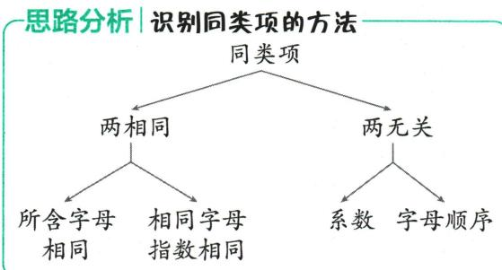

> [!success]- 必刷题
>
> > [!success] **【答案】** A
>
> > [!note]- **【解析】**
> > 
> > 【解析】根据同类项的定义可知, $ab^{3}$ 的同类项是 $3ab^{3}$ .故选A.
> >
> > 2.4 【解析】因为 $a^{m}b^{3}$ 与 $-7ab^{n}$ 是同类项, 所以 m=1, n=3, 所以 $m+n=1+3=4$ , 故答案为 4.
> >
> > ## 归纳总结
