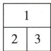
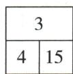
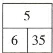

<!-- question-source:start -->
1[2025 湖北随州质检]如图,填在各方格中的三个数之间均具有相同的规律,根据此规律,n 的值是()

A. 48

B. 56

C. 63

<table><tr><td colspan="2">m</td></tr><tr><td>8</td><td>n</td></tr></table>

D. 74
<!-- question-source:end -->
