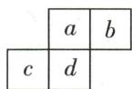

<!-- question-source:start -->
2 如图是某月的日历表,用带阴影的方框恰好盖住四个数,若这样的阴影方框可以上下左右移动,覆盖了这张日历表中的4个数,设a表示的数是x,则这4个数的和为\_\_\_\_.(用含x的代数式表示)

<table><tr><td>日</td><td>一</td><td>二</td><td>三</td><td>四</td><td>五</td><td>六</td></tr><tr><td></td><td>1</td><td>2</td><td>3</td><td>4</td><td>5</td><td>6</td></tr><tr><td>7</td><td>8</td><td>9</td><td>10</td><td>11</td><td>12</td><td>13</td></tr><tr><td>14</td><td>15</td><td>16</td><td>17</td><td>18</td><td>19</td><td>20</td></tr><tr><td>21</td><td>22</td><td>23</td><td>24</td><td>25</td><td>26</td><td>27</td></tr><tr><td>28</td><td>29</td><td>30</td><td>31</td><td></td><td></td><td></td></tr></table>

<!-- question-source:end -->
