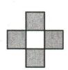
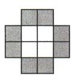
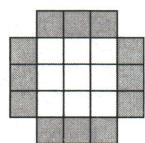

<!-- question-source:start -->
6 由白色小正方形和灰色小正方形组成的图形如图所示.

第1个图形

第2个图形
第3个图形

(1)第4个图形中白色小正方形和灰色小正方形的个数总和等于\_\_\_\_.

(2) 求第 $n$ 个图形中白色小正方形和灰色小正方形的个数总和 (用含 $n$ 的代数式表示).
<!-- question-source:end -->

![[Q00102919A1]]
