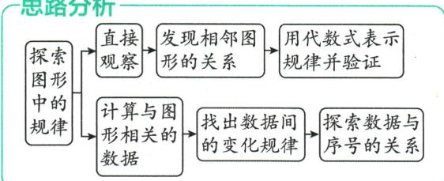

> [!success]- 必刷题
>
> > [!success] **【答案】** B
>
> > [!note]- **【解析】**
> > 日历中所示的方框左上角数字为 $n$ ，则其余三个数从小到大依次是 $n+1, n+7, n+8$ ，所以用含有 n 的等式表示这一规律为 $(n+1)(n+7)-n(n+8)=7$ 。故答案为 $(n+1)(n+7)-n(n+8)=7$ 。
> >
> > ## 4. B
> >
> > ## 思路分析
> >
> > 
> >
> > 【解析】题中第1个图有4个三角形,即 $4=3\times1+1$ ,第2个图有7个三角形,即 $7=3\times2+1$ ,第3个图有10个三角形,即 $10=3\times3+1,\cdots$ ,按此规律排列下去,第n个图有 $(3n+1)$ 个三角形,则第674个图中三角形的个数为 $3\times674+1=2023$ .
> >
> > 故选 **B**.
