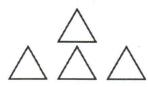
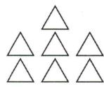
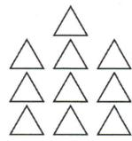

## 课时1 探索与表达规律

## 基础

## 知识点 1 与日历（表格）有关的规律探索

![[初中/课堂同步/教辅/必刷题/2026版《初中必刷题》数学 BS  7上/03_第三章_整式及其加减/课时1_探索与表达规律/questions/Q00096407.md]]
![[初中/课堂同步/教辅/必刷题/2026版《初中必刷题》数学 BS  7上/03_第三章_整式及其加减/课时1_探索与表达规律/questions/Q00096408.md]]
![[初中/课堂同步/教辅/必刷题/2026版《初中必刷题》数学 BS  7上/03_第三章_整式及其加减/课时1_探索与表达规律/questions/Q00096409.md]]
## 知识点 2 与图形有关的排列规律探索

[2024 黑龙江牡丹江中考]如图是由一些同样

建议用时-25分钟

D30

大小的三角形按照一定规律所组成的图形,第1个图有4个三角形,第2个图有7个三角形,第3个图有10个三角形,…,按照此规律排列下去,第674个图中三角形的个数是（）

  
第1个

第2个  
  
第3个

A. 2022 B. 2023 C. 2024 D. 2025

![[初中/课堂同步/教辅/必刷题/2026版《初中必刷题》数学 BS  7上/03_第三章_整式及其加减/课时1_探索与表达规律/questions/Q00096410.md]]
![[初中/课堂同步/教辅/必刷题/2026版《初中必刷题》数学 BS  7上/03_第三章_整式及其加减/课时1_探索与表达规律/questions/Q00096411.md]]
