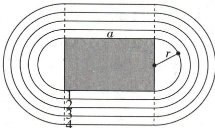

<!-- question-source:start -->
7[2025 福建泉州期中,较难]如图是某校田径运动场的平面图,最中间是长方形,长为 a 米,两端为半圆,半径为 r 米,每条跑道的宽为 1.2 米,共四条跑道.若每条跑道按内侧边线的总长度计算路程,请解答下列问题:

(1)第2跑道的总长度为\_\_\_\_米；(用含a，r的代数式表示)

(2)第3跑道的总长度为\_\_\_\_米;(用含a,r的代数式表示)

(3) 若 a=50，且要求第 1 跑道的总长度为 200 米，
①求 r 的值(结果精确到个位, $\pi$ 取 3.1);

②在①的条件下,操场中心(阴影部分)铺设人工草,跑道及操场中心两端的半圆铺设地胶,若铺设地胶的费用为50元/平方米,铺设人工草的费用为100元/平方米,则学校共需付多少铺设费用?(结果精确到个位, $\pi$ 取3.1)

<!-- question-source:end -->
