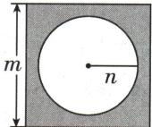

<!-- question-source:start -->
4[2025 安徽亳州期中, 中]“文房四宝”中的砚台是中国书法的必备用具. 图中砚台外部的正方形边长为 m, 内部圆形凹槽半径为 n.
(1) 用含有 m, n 的式子表示砚台阴影部分的面积为 \_\_\_\_;

(2) 当 m=14, n=6 时, 砚台阴影部分的面积是 \_\_\_\_. ( $\pi$ 取 3)

想刷题 想得睡不着
<!-- question-source:end -->

![[Q00102846A1]]
