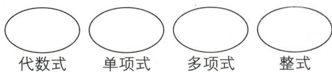

<!-- question-source:start -->
14 请把下列各式的序号分别填入如图所示的相应圈内: ①1, ②s = ab, ③r, ④ $\frac{4}{3}\pi r^{3}$ , ⑤ $\frac{1}{x+1}$ ,
⑥ $m(m+n)$ , ⑦ $\frac{2x+1}{3}$ , ⑧ $\frac{2x^{2}}{\pi}$ .

<!-- question-source:end -->

![[Q00102863A1]]
