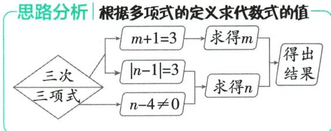

> [!success]- 必刷题
>
> > [!success] **【答案】** 4 
>
> > [!note]- **【解析】**
> > 因为 $\frac{1}{2}x^{|n-1|}+(n-4)x+2$ 是关于x的三次三项式,所以 $|n-1|=3$ ,且 $n-4\neq0$ ,所以n=-2.又因为关于x,y的单项式 $3x^{m}y$ 与该多项式次数相同,所以 $m+1=3$ ,所以m=2,所以 $n^{m}=(-2)^{2}=4$ .
