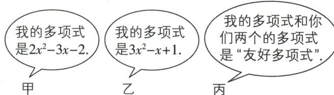

<!-- question-source:start -->
3 数学课上,老师设计了一个游戏:若两个多项式相减的结果等于第三个多项式,则称这三个多项式为“友好多项式”.甲、乙、丙三位同学各有一张写有多项式的卡片,下面是甲、乙、丙三位同学的对话.

在多项式① $-x^{2}-2x-3$ ，② $x^{2}+2x+3$ ，③ $5x^{2}-4x+1$ ，④ $5x^{2}-4x-1$ 中，丙同学卡片上的多项式可以是\_\_\_\_。（填序号）
<!-- question-source:end -->
