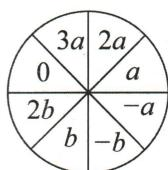

<!-- question-source:start -->
3[中]如图,有一种飞镖游戏,将飞镖圆盘八等分,每个区域内各有一个单项式,现假设你的每枚飞镖均能投中目标区域,且每个区域只能投中一次,如果只提供给你四枚飞镖且都要投出,那么要使你投中的目标区域内的单项式之和为 $a+2b$ ,共有\_\_\_\_种方式(不考虑投中目标的顺序).

<!-- question-source:end -->
