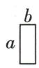
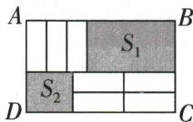

<!-- question-source:start -->
5[2025 湖南衡阳期中, 中]学习代数式求值时, 遇到这样一道题: 代数式 $ax - y + 6 + 3x - 5y - 1$ 的值与 $x$ 的取值无关, 求 $a$ 的值. 通常的解题方法是把 $x, y$ 看作字母, $a$ 看作系数, 合并同类项, 即原式 $= (a + 3)x - 6y + 5$ , 因为代数式的值与 $x$ 的取值无关, 所以含 $x$ 项的系数为 0 , 所以 $a + 3 = 0$ , 则 $a = -3$ .

(1) 若关于 x 的多项式 $(2x-3)m+2m^{2}-3x$ 的值与 x 的取值无关, 求 m 的值;

(2)7 张如图(1)的小长方形, 长为 a, 宽为 b (a > b), 按照图(2)方式不重叠地放在大长方形 ABCD 内, 大长方形中未被覆盖的两个部分中(图中阴影部分), 右上角的面积为 $S_{1}$ , 左下角的面积为 $S_{2}$ , 当 AB 的长变化时, $S_{1} - S_{2}$ 的值始终保持不变,求 a 与 b 的数量关系.

  
图(1)

  
图(2)
<!-- question-source:end -->
