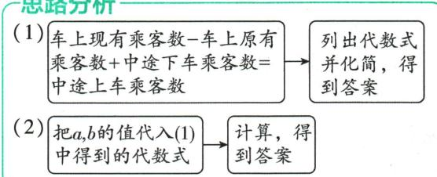

> [!success]- 必刷题
>
> > [!success] **【答案】** $6n+6$
>
> > [!note]- **【解析】**
> > 另外两个偶数分别为 $2n+2$ ， $2n+4$ ，所以 $2n+(2n+2)+(2n+4)=2n+2n+2+2n+4=6n+6$ 。故答案为 $6n+6$ 。
> >
> > 
> >
> > 【解】(1)由题意得 $(8m-5n)-(3m-n)+\frac{1}{2}(3m-n)=8m-5n-3m+n+\frac{3}{2}m-\frac{1}{2}n=\frac{13}{2}m-\frac{9}{2}n$ ，即中途上车的乘客有 $\left(\frac{13}{2}m-\frac{9}{2}n\right)$ 人.
> > (2) 当 m=10, n=8 时，中途上车的乘客有 $\frac{13}{2} \times 10 - \frac{9}{2} \times 8 = 29$ （人）.
> >
> > ## 刷易错·
