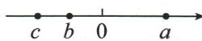

<!-- question-source:start -->
5[较难]已知 a, b, c 在数轴上的位置如图所示.

(1) 化简: $\left|a+b\right|-\left|c-b\right|+\left|b-a\right|$ ;

(2) 若 a 的绝对值的相反数是 -2, -b 的倒数是它本身, $c^{2}=4$ , 求 $-a+2b+c-(a+b-c)$ 的值.

电子错题本鸭
<!-- question-source:end -->
