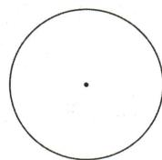

<!-- question-source:start -->
10[2025 山东淄博质检]将如图所示的一个圆分割成四个扇形, 它们的圆心角的度数比为 2:3:4:3.
(1) 分别求出这四个扇形的圆心角的度数, 并画出这四个扇形;
(2) 若圆的半径为 2 cm, 请分别求出这四个扇形的面积.

是个新“烤”鸭

电子错题本鸭
<!-- question-source:end -->

![[Q00103026A1]]
